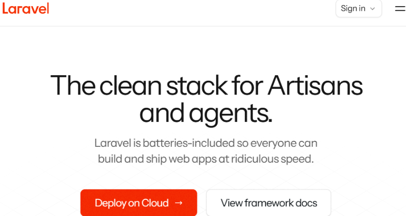
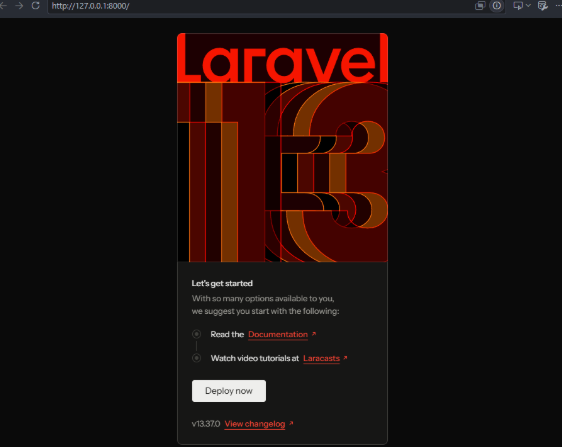
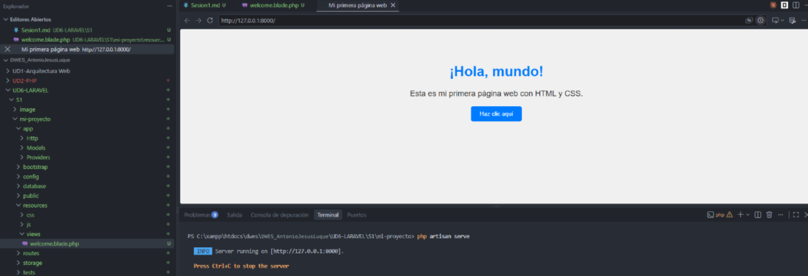

# Primeros pasos con Laravel

## Otras opciones además de Laravel

**Symfony:** Es el competidor más cercano y de perfil más empresarial. De hecho, Laravel se apoya internamente en varios de sus componentes. Resulta muy adecuado para aplicaciones extensas, complejas o pensadas para mantenerse durante muchos años, donde se necesita una arquitectura muy modular y un control riguroso del diseño.

### Un poco de historia

Laravel es un framework libre para PHP desarrollado por Taylor Otwell, cuya primera versión estable salió en junio de 2011. Su creador tomó ideas de herramientas de otros lenguajes, como Ruby on Rails, Sinatra y ASP.NET MVC, con el objetivo de ofrecer una sintaxis clara y expresiva. Entre sus aportaciones destaca **Eloquent ORM**, que permite trabajar con las bases de datos a través de objetos en lugar de escribir consultas a mano.

[Sitio web oficial](https://laravel.com/)



### Cómo instalar y poner en marcha Laravel

En esta sesión se persiguen tres metas:

* [X] preparar y configurar un entorno de desarrollo apto para Laravel,
* [X] generar un primer proyecto y
* [X] dejar constancia de cada paso mediante  **evidencias** .



### Uso de Composer

Composer permite generar el proyecto de manera casi automática: durante el proceso solo hace preguntas de sí/no para decidir las opciones de configuración.

Verificación del entorno de trabajo

- Sistema operativo: Windows 11
- Versión de PHP: 8.5.11
- Compilación empleada: ZTS Visual C++ 2022 x64
- Versión de Git: 2.51.1.windows.1

### Página de inicio

Al modificar el archivo welcome.blade.php se comprueba cómo cambia lo que muestra la página principal de la aplicación.

```php
<!DOCTYPE html>
<html lang="es">
<head>
    <meta charset="UTF-8">
    <meta name="viewport" content="width=device-width, initial-scale=1.0">
    <title>Mi primera página web</title>

    <style>
        body {
            font-family: Arial, sans-serif;
            background-color: #f0f0f0;
            text-align: center;
            padding: 50px;
        }

        h1 {
            color: #007bff;
        }

        p {
            color: #333;
            font-size: 18px;
        }

        button {
            background-color: #007bff;
            color: white;
            border: none;
            padding: 10px 20px;
            border-radius: 5px;
            cursor: pointer;
        }

        button:hover {
            background-color: #0056b3;
        }
    </style>
</head>
<body>

    <h1>¡Hola, mundo!</h1>
    <p>Esta es mi primera página web con HTML y CSS.</p>
    <button>Haz clic aquí</button>

</body>
</html>
```


