# UD6 · Sesión 2 · Estructura, entorno y Artisan

# 2.1. Estructura de carpetas

## Carpeta app

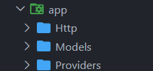

Dentro de la carpeta app se ubican tanto los modelos como los controladores.

Generamos el controlador UserController con el comando: php artisan make:controller UserController

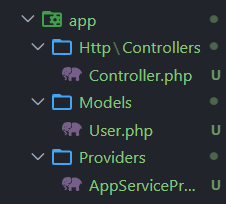

A continuación están los middleware, que actúan como intermediarios entre un proceso y otro; es decir, tratan las peticiones antes o después de que estas lleguen al controlador.

Generamos el middleware con --> php artisan make:middleware UserMiddleware

Resultado: se crea UserMiddleware, que incluye por defecto una función encargada de gestionarlo. Su contenido se explicará más adelante.

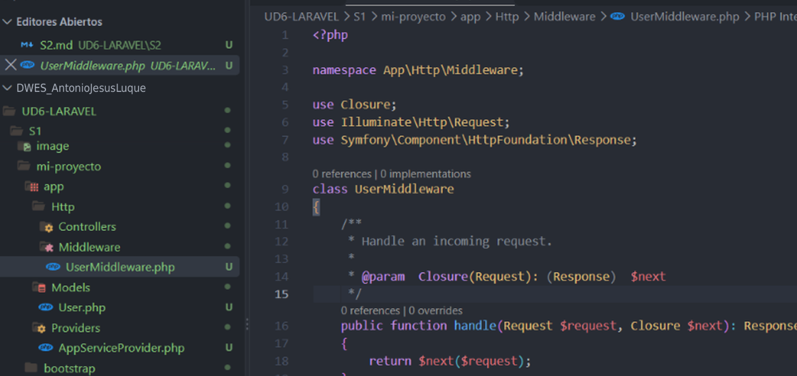

Generamos la carpeta request con --> php artisan make:request UserRequest

Los request que se utilizan junto al middleware sirven para validar datos.

Carpeta Models: aloja los modelos, y **cada modelo representa una tabla de la base de datos**.

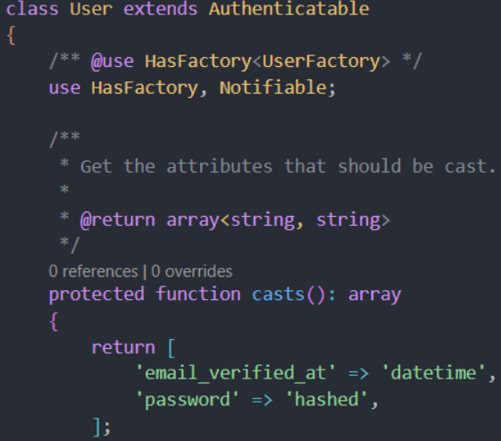

Los providers se ocupan de registrar los servicios.

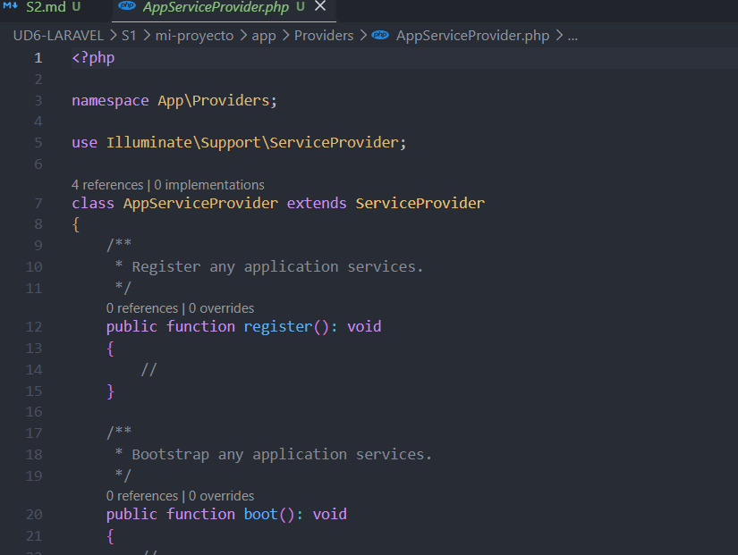

## Carpeta routes

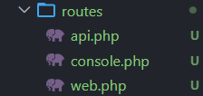

Creamos una nueva vista llamada hola.blade.php y, en welcome.php, añadimos la ruta correspondiente.

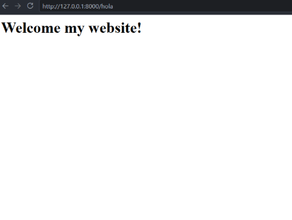

La API se instala por separado y se verá en el siguiente tema.

## Carpeta resources

Una de las subcarpetas más importantes es la de vistas (views).

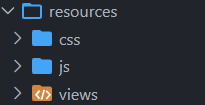

## Carpeta config

Contiene los archivos de configuración de la aplicación. Uno de los más relevantes es app.php, en el que se puede modificar el nombre de la aplicación.

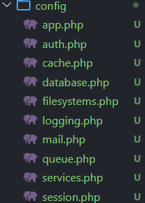

## Carpeta database

Las migraciones son el punto de partida.

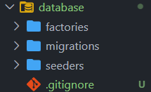

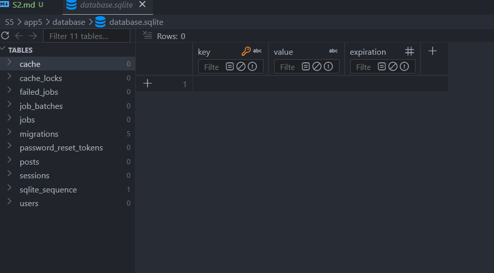

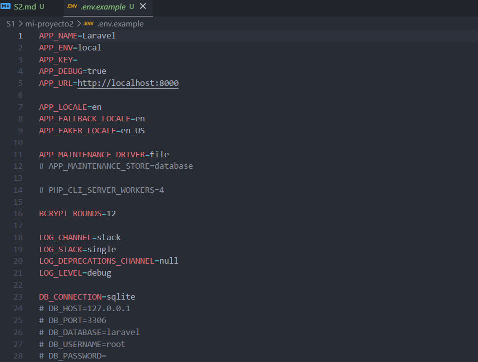

Los seeders se encargan de rellenar la base de datos con datos.

## Carpeta public

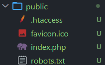

## Carpeta storage

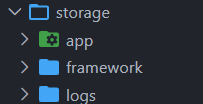

*Laravel.log

## Carpeta bootstrap

En el archivo app.php se modifican las conversiones.

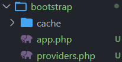

## Carpeta tests

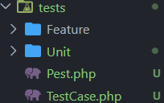

Ya se incluyen ejemplos de tests.

```php
<?php

namespace Tests\Feature;

// use Illuminate\Foundation\Testing\RefreshDatabase;
use Tests\TestCase;

class ExampleTest extends TestCase
{
    /**
     * A basic test example.
     */
    public function test_the_application_returns_a_successful_response(): void
    {
        $response = $this->get('/');

        $response->assertStatus(200);
    }
}
```

Si accedemos a una ruta inexistente, por ejemplo, el test no se superará.

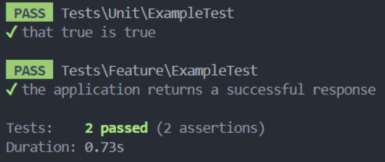

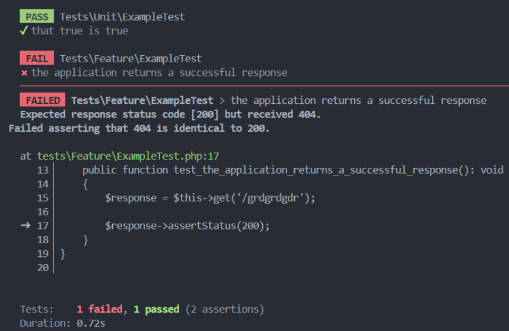

## Carpeta vendor

Sus archivos nunca se modifican ni se suben a Git.

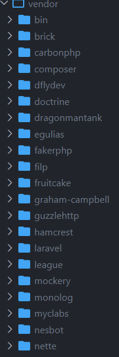

# Práctica

Cambiamos el seeder para que use nuestro nombre real.

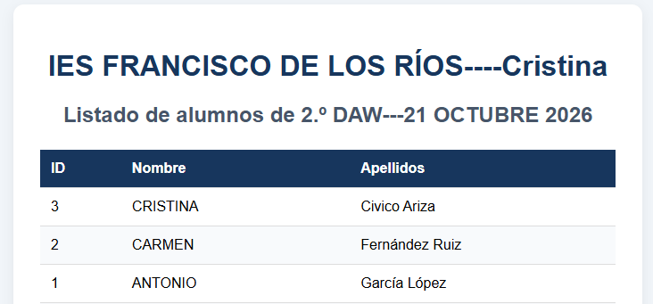

Si editamos el controlador de alumnos, podemos hacer que la lista se ordene por ID.

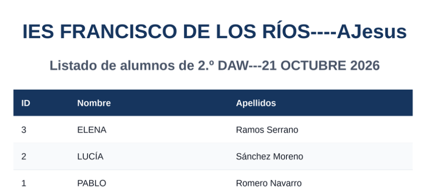

# El archivo .env

Se encuentra en la raíz del proyecto y almacena la configuración que varía según el entorno.

# Artisan CLI

Es la herramienta de línea de comandos de Laravel; automatiza tareas como crear controladores, ejecutar migraciones o arrancar el servidor.
