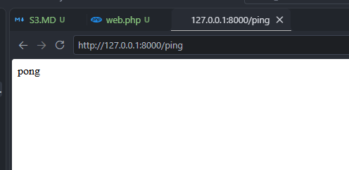
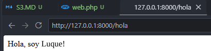
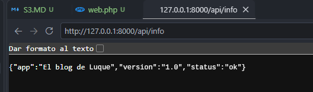
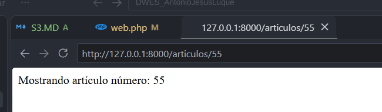
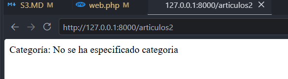
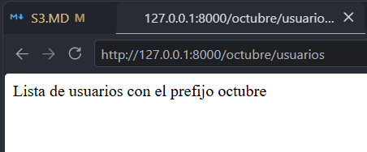
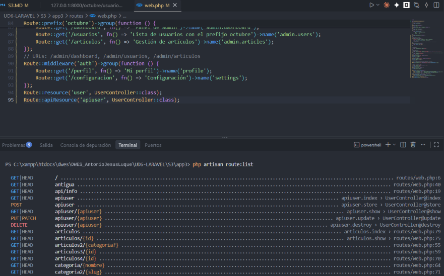
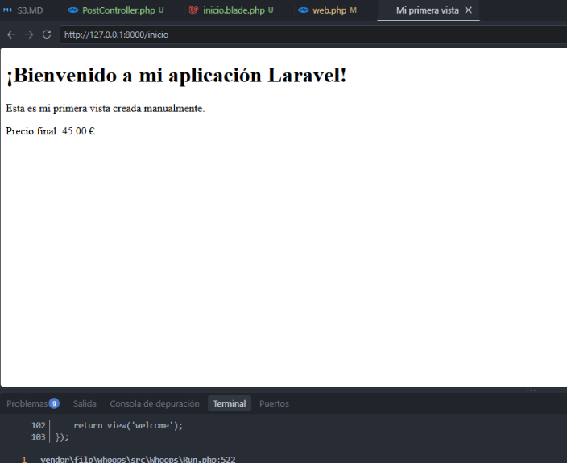
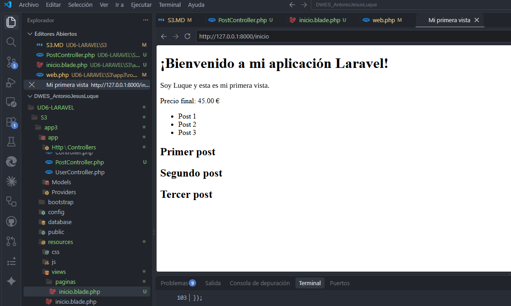

# Rutas y Vistas

## Devolver texto plano

```php
<?php

use Illuminate\Support\Facades\Route;

Route::get('/', function () {
    return view('welcome');
});

Route::any('/ping', function () {
    return 'pong';
});
```





## Devolver una vista Blade

```php
// Redirigir indicando un código de estado
Route::get('/antigua', function () {
    return redirect('/hola', 301);
    // El 301 es el código de redirección permanente.
});
```

## Parámetros





## Rutas con prefijo



## Rutas de recurso



*Ojo: la diferencia entre resource y apiResource es MUY IMPORTANTE, entra en el EXAMEN.

## Resultado final




