# Sesion 4 - Vistas --

## Creación del proyecto basico para la sesión

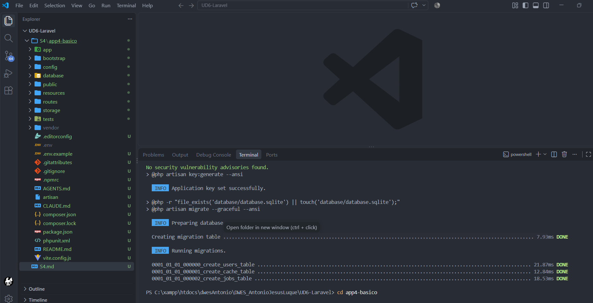

## En el .env cambiamos tanto SESSION_DRIVER COMO CACHE_STORE para asignarle ¨file¨

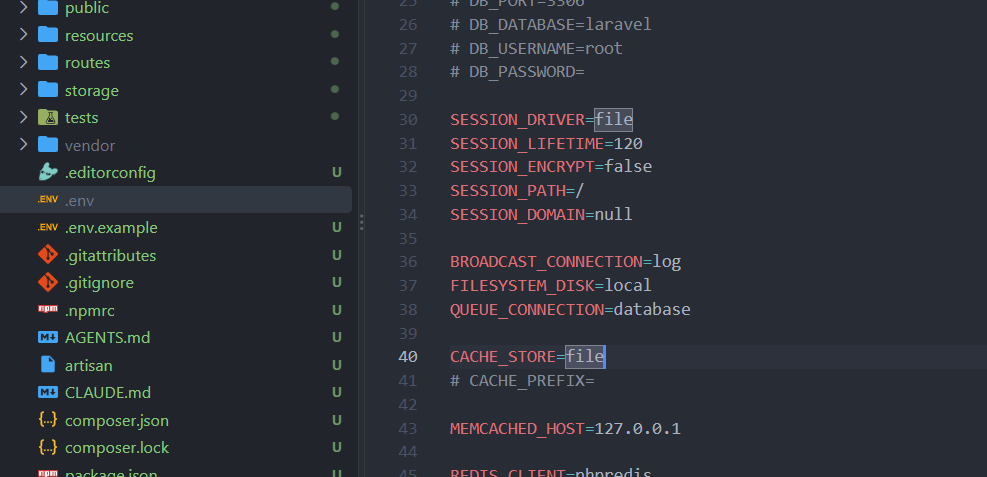

# Proyecto vistas

con algunas instrucciones podemos rellenar los huevos marcados por @yield

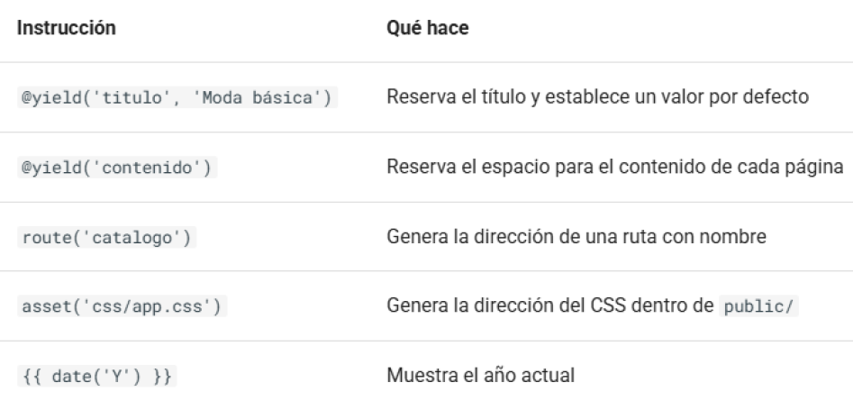

```php
<!DOCTYPE html>
<html lang="es">
<head>
    <meta charset="UTF-8">
    <meta name="viewport" content="width=device-width, initial-scale=1">

    <title>@yield('titulo', 'Moda básica')</title>

    <link rel="stylesheet" href="{{ asset('css/app.css') }}">
</head>
<body>
    <header>
        <h2>Moda básica</h2>

        <nav>
            <a href="{{ route('inicio') }}">Inicio</a>
            <a href="{{ route('catalogo') }}">Catálogo</a>
            <a href="{{ route('contacto') }}">Contacto</a>
        </nav>
    </header>

    <main>
        @yield('contenido')
    </main>

    <footer>
        <p>© {{ date('Y') }} Moda básica · Proyecto de clase</p>
    </footer>
</body>
</html>
```

# Editamos el layout desde inicio

```php
@extends('layouts.app')

@section('titulo', 'Inicio')

@section('contenido')
    <h1>Bienvenido a Moda básica</h1>

    <p>Descubre nuestras prendas de ejemplo.</p>

    <a href="{{ route('catalogo') }}">Ver catálogo</a>
@endsection
```

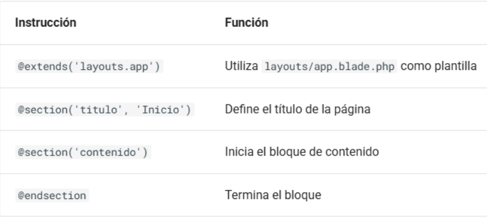

## Pasamos los datos a la vista

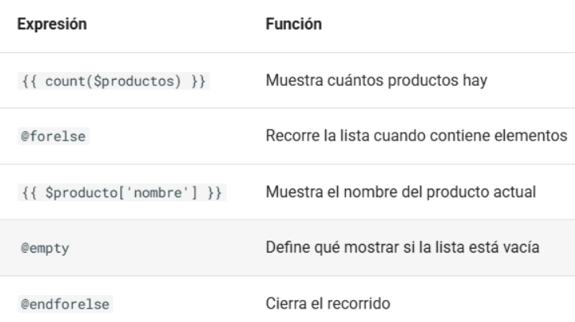

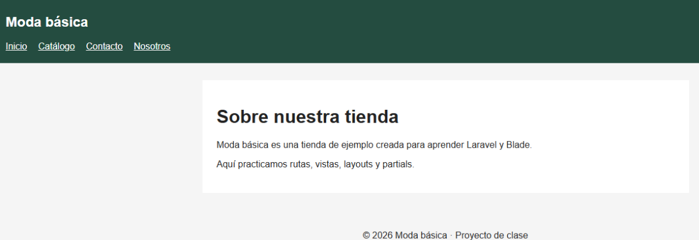

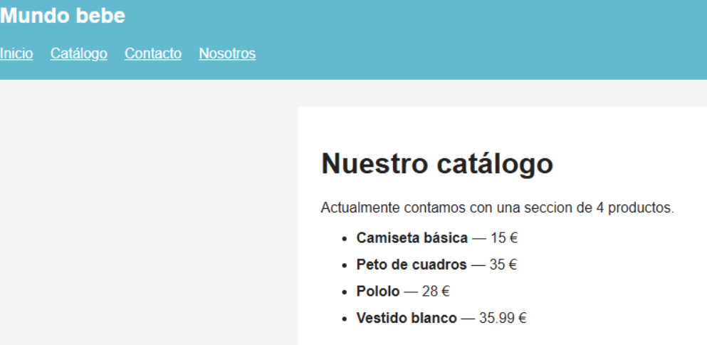

# S4 - layouts

## app4-layouts · Layouts y componentes en BladeHemos visto : route, parent, yield, section, include

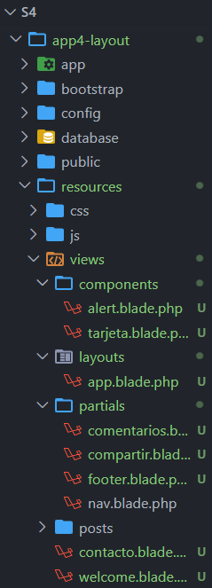

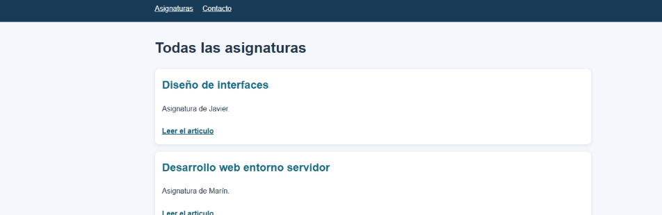

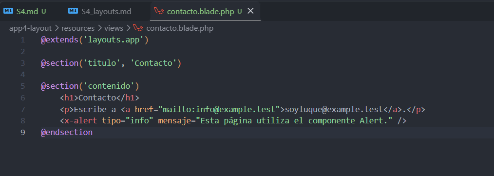

## adicion de componentes anonimos

```php
{{--
    Componente: alert
    Uso: <x-alert tipo="exito" mensaje="Texto" />
    Variables que recibe:
      - $tipo    : 'exito', 'error' u otro (información)
      - $mensaje : texto de la alerta
      - $slot    : contenido escrito entre las etiquetas
--}}
<div class="alert alert-{{ $tipo }}" role="status">
    {{-- Etiqueta en negrita según el tipo de alerta --}}
    <strong>
        @if ($tipo === 'error')
            Error:
        @elseif ($tipo === 'exito')
            Correcto:
        @else
            Información:
        @endif
    </strong>

    {{-- Mensaje recibido como atributo --}}
    {{ $mensaje }}

    {{-- Mensaje recibido entre las etiquetas <x-alert>...</x-alert> --}}
    {{ $slot }}
</div>
```

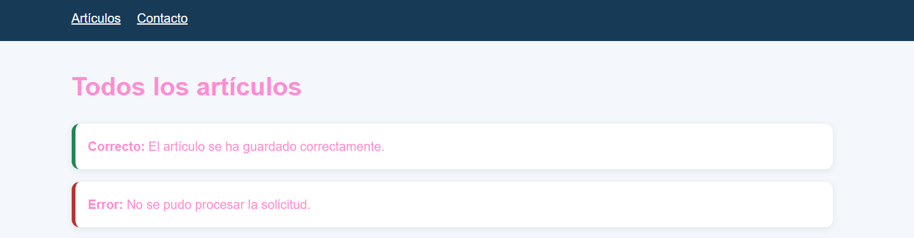
