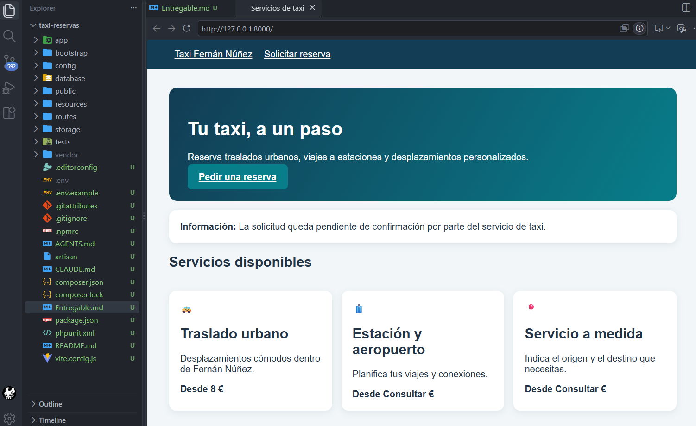
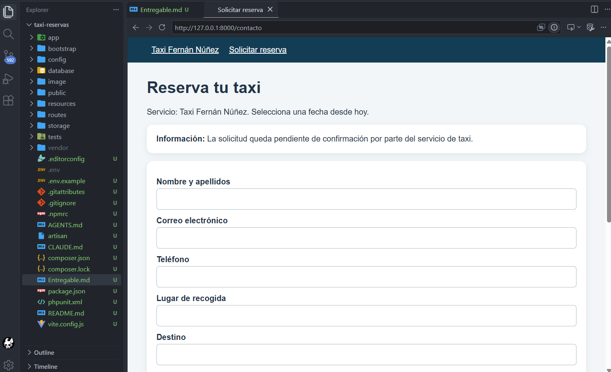

# Taxi - Proyecto

La página principal presenta los servicios disponibles y un formulario permite enviar una solicitud de reserva de taxi en Fernan Nuñez

## Instrucciones de arranque

1. Usamos composer para crear el proyecto con:  "composer create-project laravel/laravel taxi-reservas"
2. Creamos la estructura de las carpetas y archivos que le haga falta
3. Completar las lineas designadas para la ejecucion del codigo






## Cómo se relacionan rutas, vistas, layout, parciales y componentes

El archivo routes/web.php es el punto de partida de la aplicación. Cada ruta es una función anónima que prepara los datos necesarios y devuelve una vista mediante view().

```php
<?php

use Illuminate\Http\Request;
use Illuminate\Support\Facades\Route;

Route::get('/', function () {
    $servicios = [
        ['nombre' => 'Traslado urbano', 'precio' => '8', 'icono' => '🚕', 'descripcion' => 'Desplazamientos cómodos dentro de Fernán Núñez.'],
        ['nombre' => 'Estación y aeropuerto', 'precio' => 'Consultar', 'icono' => '🧳', 'descripcion' => 'Planifica tus viajes y conexiones.'],
        ['nombre' => 'Servicio a medida', 'precio' => 'Consultar', 'icono' => '📍', 'descripcion' => 'Indica el origen y el destino que necesitas.'],
    ];

    return view('inicio', compact('servicios'));
})->name('inicio');

Route::get('/contacto', function () {
    $fechaMinima = now()->format('Y-m-d');

    return view('contacto', ['fechaMinima' => $fechaMinima])
        ->with('empresa', 'Taxi Fernán Núñez');
})->name('contacto');

Route::post('/contacto', function (Request $request) {
    $datos = $request->validate([
        'nombre' => ['required', 'string', 'min:2', 'max:80'],
        'email' => ['required', 'email', 'max:150'],
        'telefono' => ['required', 'string', 'min:9', 'max:20'],
        'origen' => ['required', 'string', 'max:120'],
        'destino' => ['required', 'string', 'max:120'],
        'fecha' => ['required', 'date', 'after_or_equal:today'],
        'hora' => ['required', 'date_format:H:i'],
        'pasajeros' => ['required', 'integer', 'between:1,8'],
        'detalles' => ['nullable', 'string', 'max:500'],
    ]);

    return redirect()->route('contacto')
        ->with('reservaOk', 'Solicitud recibida para ' . $datos['nombre'] . '. Te contactaremos para confirmar.');
})->name('reservas.store');
```

* Vistas y layout. Las vistas inicio y contacto comienzan con @extends('layouts.app'), así que heredan la estructura HTML compartida.
* Parciales. Son fragmentos reutilizables que se añaden con @include. El layout incluye partials.nav y partials.footer, de modo que el menú y el pie de página aparecen en todas las páginas sin duplicar código.
* Componentes anónimos. Son archivos ubicados en resources/views/components/ que se usan como etiquetas <x-...> y no requieren una clase PHP.

## Comprobaciones realizadas

* [X] La página de inicio muestra las tarjetas de servicio.
* [X] Los enlaces del menú dirigen a las páginas correctas.
* [X] El formulario incluye el token CSRF y envía los datos por POST.
* [X] Si faltan datos, se muestran los errores y se mantienen los valores introducidos.
* [X] Si los datos son válidos, se muestra una confirmación. No hay controladores ni conexión a base de datos.
