# 5.1 BDD Config

## estructura de directorios de la bbdd

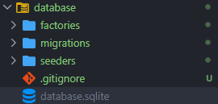

## carpeta migraciones

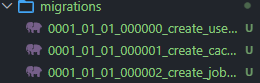

## conexiones en .env

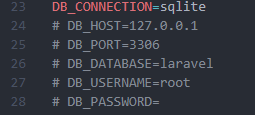

## funcion up()

define los cambios a aplicar

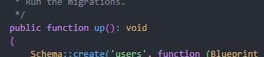

## funcion down()

define cómo deshacer esos cambios

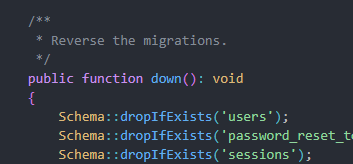

## reacion de la tabla usuario

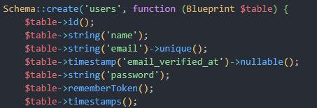

## Crear migracion

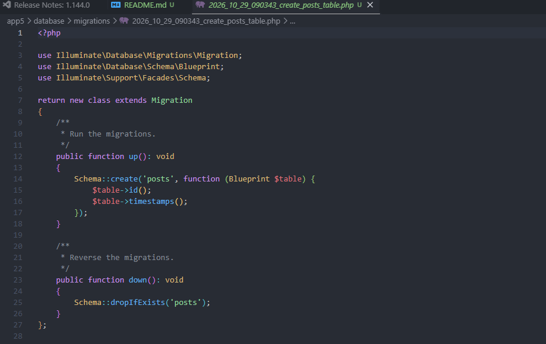

## Ejecutar migraciones

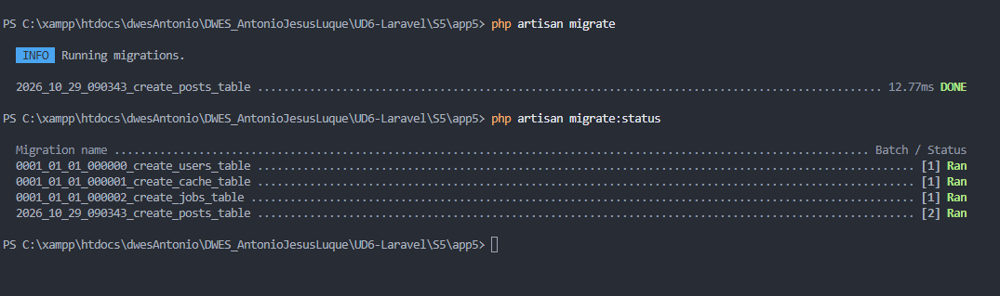

## Revertir migraciones

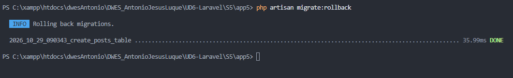

## Crear modelos

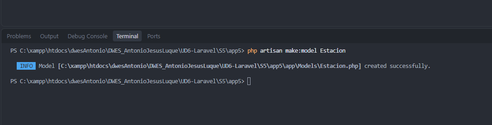

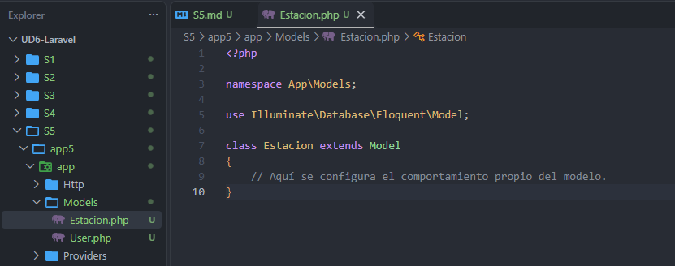

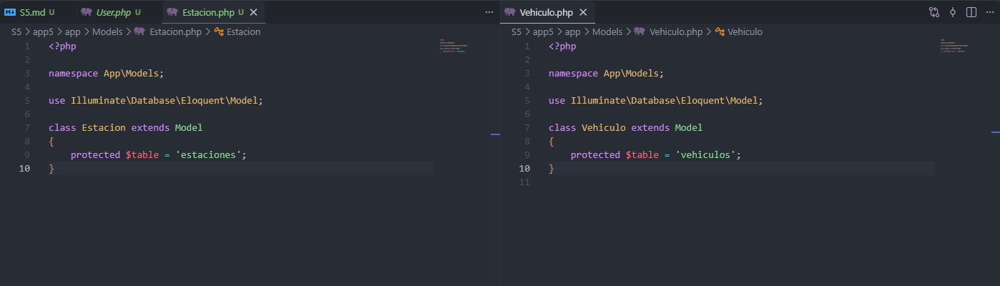

Por seguridad, Eloquent protege los modelos frente a la asignación masiva. Hay que indicar qué campos se pueden asignar con `$fillable`

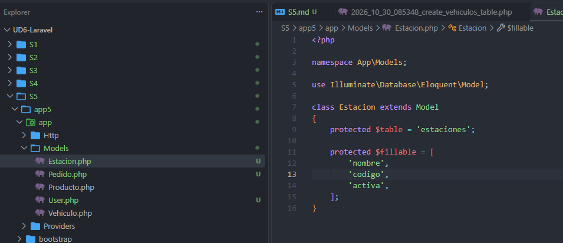

En `Vehiculo` se puede autorizar la clave foránea y los datos propios del vehículo

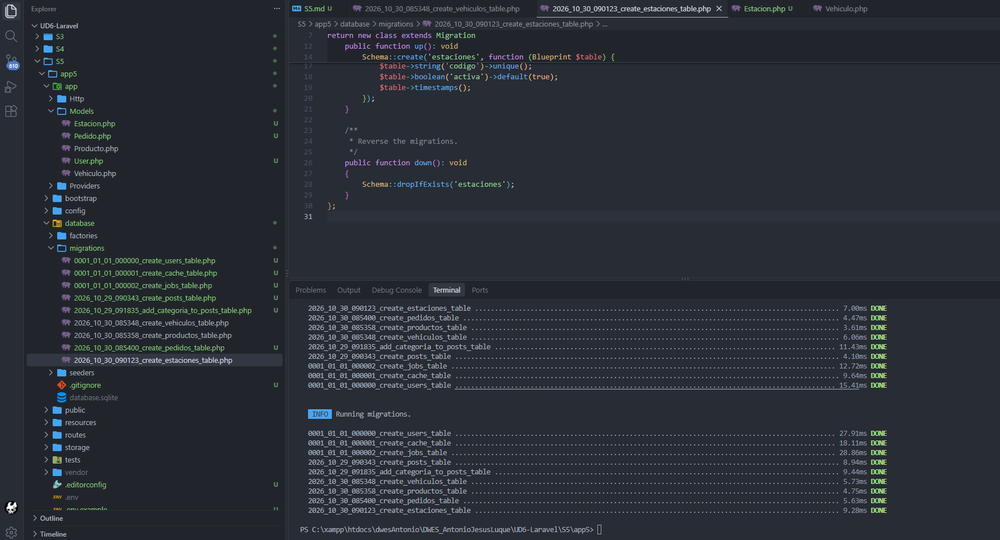

# Solucion app5

Estacion

```php
<?php

namespace App\Models;

use Illuminate\Database\Eloquent\Model;
use Illuminate\Database\Eloquent\Relations\HasMany;

class Estacion extends Model
{
    //
    protected $table = 'estaciones';

    protected $fillable = [
        'nombre',
        'codigo',
        'activa',
    ];

    public function vehiculos(): HasMany
    {
        return $this->hasMany(Vehiculo::class);
    }
}
```

vehiculo

```php
<?php

namespace App\Models;

use Illuminate\Database\Eloquent\Model;
use Illuminate\Database\Eloquent\Relations\BelongsTo;

class Vehiculo extends Model
{
    //
    // protected $table = 'vehiculos';
    // protected $primaryKey = 'codigo';

    // Define qué campos permites registrar masivamente
    protected $fillable = [
        'estacion_id',  // Foreign key to the Estacion model
        'modelo',
        'tipo',
        'disponible',
    ];

    public function estacion(): BelongsTo
    {
        return $this->belongsTo(Estacion::class);
    }
}
```

migracion create vehiculos

```php
<?php

use Illuminate\Database\Migrations\Migration;
use Illuminate\Database\Schema\Blueprint;
use Illuminate\Support\Facades\Schema;

return new class extends Migration
{
    /**
     * Run the migrations.
     */
    public function up(): void
    {
        Schema::create('vehiculos', function (Blueprint $table) {
            $table->id();
            $table->foreignId('estacion_id')
                ->constrained('estaciones')
                ->cascadeOnDelete();
            $table->string('modelo', 100);
            $table->string('tipo', 30);
            $table->boolean('disponible')->default(true);
            $table->timestamps();
        });
    }

    /**
     * Reverse the migrations.
     */
    public function down(): void
    {
        Schema::dropIfExists('vehiculos');
    }
};
```

migracion create estaciones

```php
<?php

use Illuminate\Database\Migrations\Migration;
use Illuminate\Database\Schema\Blueprint;
use Illuminate\Support\Facades\Schema;

return new class extends Migration
{
    /**
     * Run the migrations.
     */
    public function up(): void
    {
        Schema::create('estaciones', function (Blueprint $table) {
            $table->id();
            $table->string('nombre');
            $table->string('codigo')->unique();
            $table->boolean('activa')->default(true);
            $table->timestamps();
        });
    }

    /**
     * Reverse the migrations.
     */
    public function down(): void
    {
        Schema::dropIfExists('estaciones');
    }
};
```

## tinker

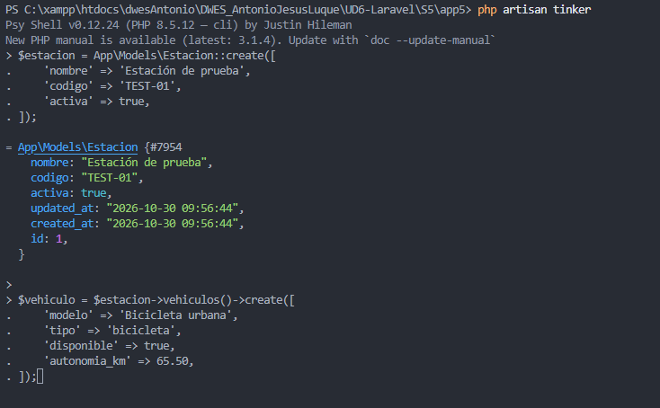

## mostrar los datos en una vista

Después de crear y probar los modelos, presenta los datos en una página web. La consulta se hará desde una función anónima

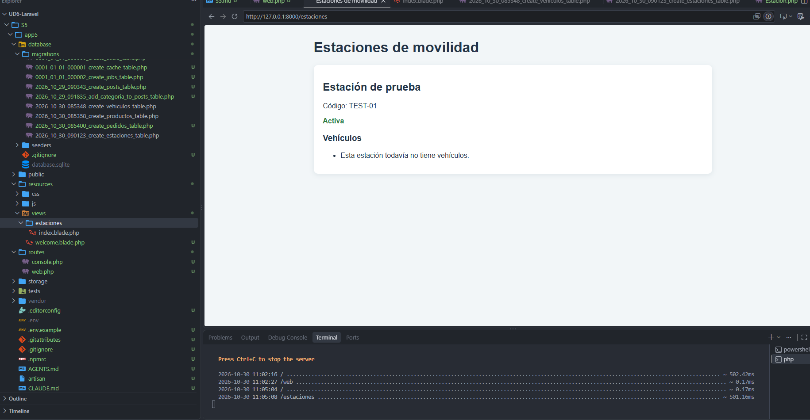

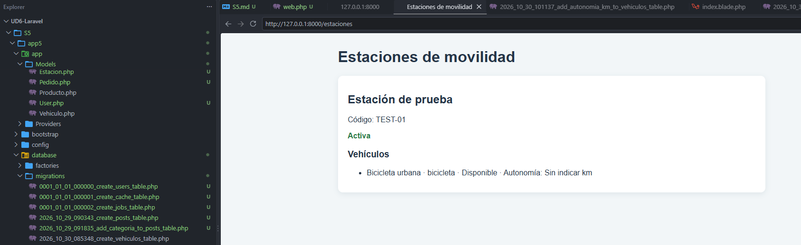


## show.blade.php

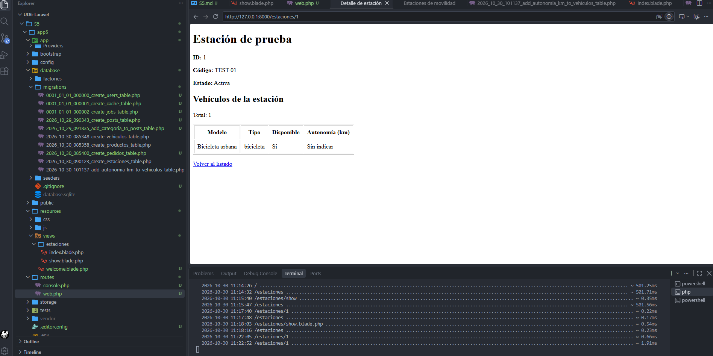
