# Controladores

En esta sesión trabajamos con los **controladores** en Laravel: la pieza que recibe las peticiones, interactúa con el modelo y devuelve una vista o una redirección. Desarrollamos dos ejemplos: un catálogo de productos (`ProductoController`) y una gestión de usuarios con un *resource controller* (`UserController`).

---

## Crear modelo y migración

Lo primero es crear el modelo `Producto` junto con su migración. En la siguiente imagen podemos ver el comando de Artisan utilizado para generarlos a la vez.

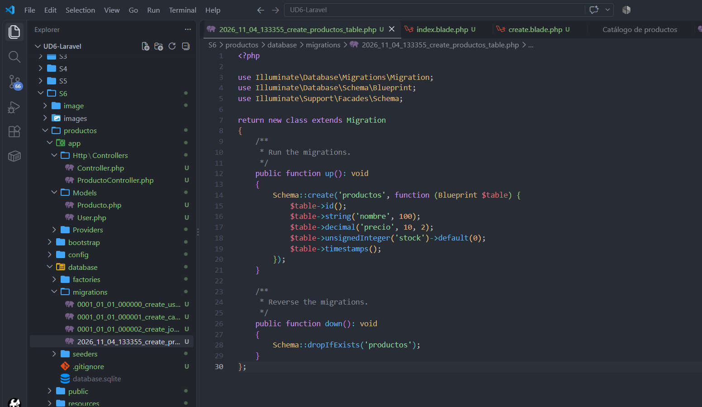

Laravel crea el archivo `app/Models/Producto.php` y una migración dentro de `database/migrations`, con la fecha y hora en el nombre para mantener el orden de ejecución.

### Configurar el modelo

En esta imagen podemos ver el modelo `Producto` ya configurado. Se define la propiedad `$fillable` con los campos `nombre`, `precio` y `stock`, que son los únicos atributos que se podrán asignar de forma masiva con métodos como `Producto::create()`. Esto protege la aplicación frente a la asignación masiva de campos no deseados.

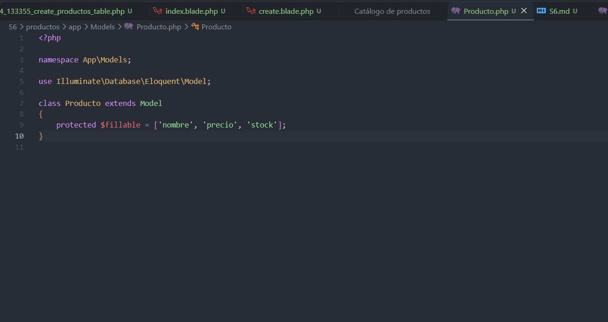

### Definir la migración

En la migración, dentro del método `up()`, se define la estructura de la tabla `productos`:

- `id()`: clave primaria autoincremental.
- `string('nombre', 100)`: nombre del producto, con un máximo de 100 caracteres.
- `decimal('precio', 10, 2)`: precio con hasta 10 dígitos y 2 decimales.
- `unsignedInteger('stock')->default(0)`: unidades disponibles, sin negativos y con valor por defecto 0.
- `timestamps()`: columnas `created_at` y `updated_at`.

El método `down()` revierte el cambio eliminando la tabla con `dropIfExists('productos')`.

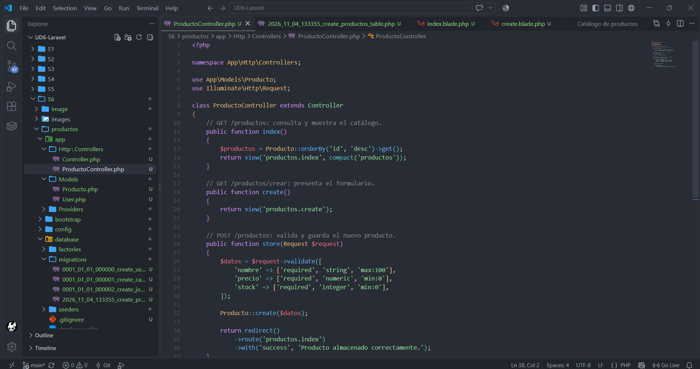

---

## Crear el controlador

Ahora creamos `ProductoController`. En la imagen se muestra el controlador con sus métodos principales, cada uno documentado con un comentario que indica la ruta y su función:

- `index()`: consulta todos los productos ordenados por `id` descendente y los envía a la vista `productos.index` mediante `compact('productos')`.
- `create()`: muestra el formulario para añadir un producto nuevo.
- `store(Request $request)`: valida los datos recibidos (`nombre` obligatorio y de máximo 100 caracteres, `precio` numérico mínimo 0, `stock` entero mínimo 0), guarda el producto con `Producto::create($datos)` y redirige al listado con un mensaje de éxito.

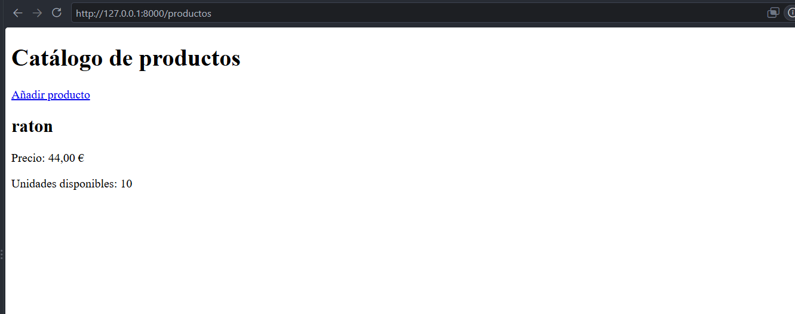

---

## Ejecución

Una vez definidas las rutas y las vistas, arrancamos el servidor de desarrollo y accedemos a `http://127.0.0.1:8000/productos`. En esta imagen podemos ver el resultado: la página **Catálogo de productos** con un enlace para *Añadir producto* y el producto de prueba "raton", con su precio (44,00 €) y las unidades disponibles (10). Por ahora la vista no tiene estilos, solo HTML básico.

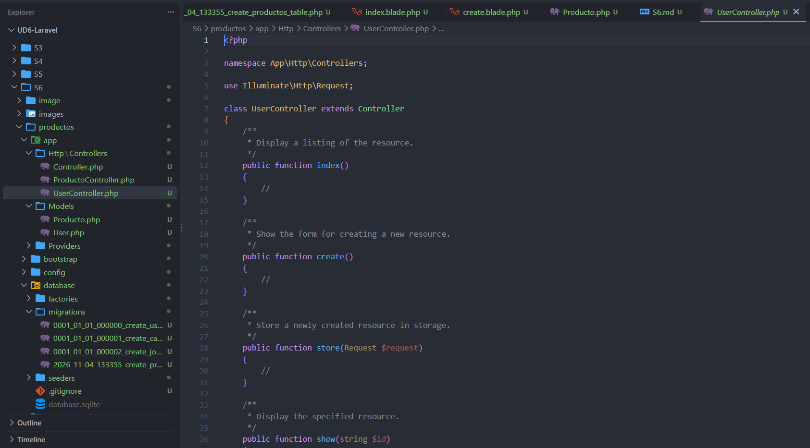

---

## Resource controller

Laravel permite generar un controlador con todos los métodos típicos de un CRUD ejecutando:

```bash
php artisan make:controller UserController --resource
```

Se nos creará el archivo con los métodos vacíos, y nosotros los completaremos.

En la primera imagen podemos ver el `UserController` recién generado: contiene los métodos `index`, `create`, `store`, `show`, etc., cada uno con un comentario de documentación en inglés y el cuerpo vacío (`//`), a la espera de que escribamos la lógica.

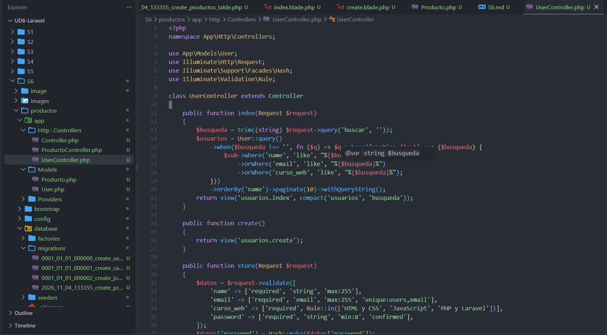

En la segunda imagen vemos el controlador ya completado. Entre los elementos más destacados:

- **Importaciones**: se usan `User`, `Request`, la fachada `Hash` para cifrar contraseñas y `Rule` para validaciones avanzadas.
- **`index()`**: implementa un buscador. Recoge el parámetro `buscar` de la URL, y si no está vacío filtra por `name`, `email` o `curso_web` con `like`. Después ordena por nombre, pagina de 10 en 10 y conserva la búsqueda entre páginas con `withQueryString()`.
- **`create()`**: devuelve la vista con el formulario de alta.
- **`store()`**: valida los datos: `name` y `email` obligatorios (con `email` único en la tabla `users`), `curso_web` restringido a una lista de valores permitidos con `Rule::in([...])` (*HTML y CSS*, *JavaScript* o *PHP y Laravel*) y `password` con mínimo 8 caracteres y confirmación. Antes de guardar, la contraseña se cifra con `Hash::make()`.

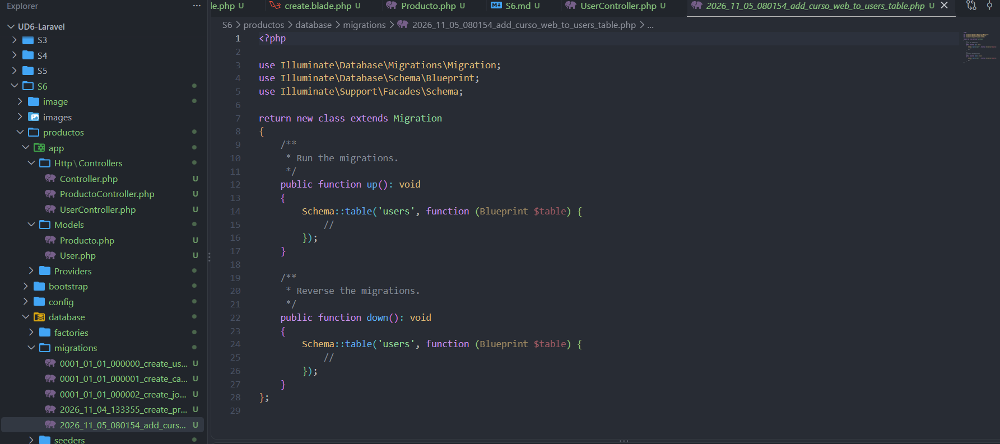

---

## Creamos la migración

Como los usuarios necesitan un campo nuevo para el curso, creamos una migración que añade la columna `curso_web` a la tabla `users`. En la imagen podemos ver el archivo recién generado (`..._add_curso_web_to_users_table.php`): por ahora los métodos `up()` y `down()` solo contienen `Schema::table('users', ...)` con el cuerpo vacío. Dentro de `up()` añadiremos la columna y en `down()` la eliminaremos para poder revertir el cambio.

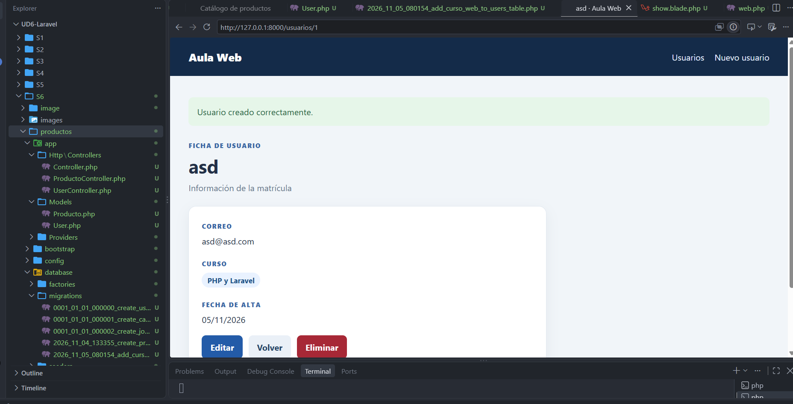

Tras completar y ejecutar la migración, comprobamos el resultado en el navegador. En esta imagen vemos la **ficha de usuario** (`/usuarios/1`) tras crear un usuario: aparece el mensaje de confirmación *"Usuario creado correctamente."* y los datos del alumno (correo, curso "PHP y Laravel" y fecha de alta), junto con los botones **Editar**, **Volver** y **Eliminar**. También se aprecia el menú superior con los enlaces *Usuarios* y *Nuevo usuario*.

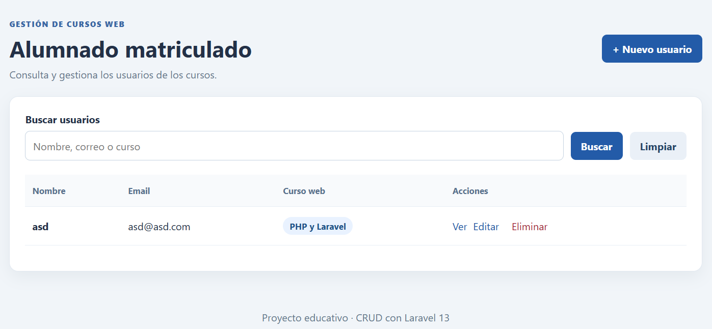

En esta imagen podemos ver el listado **Alumnado matriculado**, con el buscador (que permite filtrar por nombre, correo o curso con los botones *Buscar* y *Limpiar*) y una tabla con las columnas Nombre, Email, Curso web y Acciones (*Ver*, *Editar*, *Eliminar*). Arriba a la derecha está el botón **+ Nuevo usuario**.

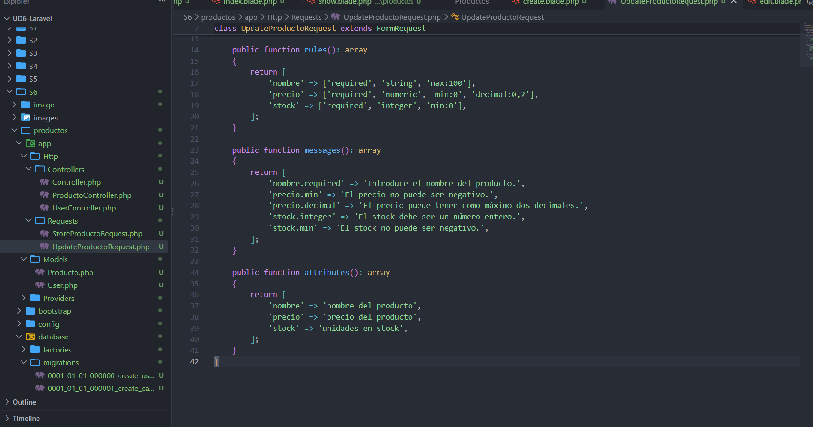

---

## FormRequests

Para no sobrecargar el controlador con reglas de validación, Laravel permite moverlas a clases específicas llamadas **FormRequests**. En el proyecto tenemos `StoreProductoRequest` (para crear) y `UpdateProductoRequest` (para actualizar), dentro de `app/Http/Requests`.

En la imagen podemos ver `UpdateProductoRequest`, que contiene tres métodos:

- `rules()`: define las reglas de validación. `nombre` es obligatorio, texto y de máximo 100 caracteres; `precio` es obligatorio, numérico, mínimo 0 y con un máximo de 2 decimales (`decimal:0,2`); `stock` es obligatorio, entero y mínimo 0.
- `messages()`: personaliza los mensajes de error en español, por ejemplo *"Introduce el nombre del producto."* o *"El stock debe ser un número entero."*.
- `attributes()`: cambia el nombre con el que aparecen los campos en los mensajes de error (por ejemplo, `stock` se muestra como *"unidades en stock"*).

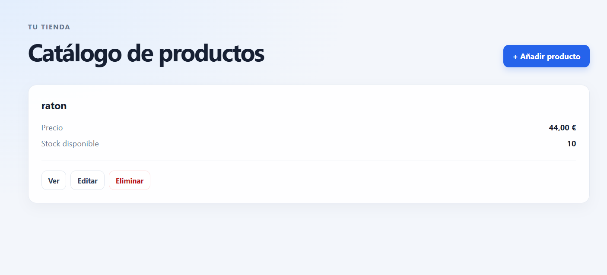

---

## Mejora visual del catálogo

Por último, he mejorado con CSS el catálogo de productos. En esta imagen podemos ver el nuevo diseño: un encabezado con el título destacado, un botón **+ Añadir producto** en azul, y cada producto mostrado en una tarjeta con su nombre, precio, stock disponible y los botones de acción **Ver**, **Editar** y **Eliminar** (este último resaltado en rojo para indicar que es una acción destructiva). Comparado con la primera versión sin estilos, la interfaz resulta mucho más clara y agradable.


