# GameManager: documentación paso a paso

**Módulo:** Desarrollo Web en Entorno Servidor (DWES) · UD6, Sesión 7
**Actividad:** Catálogo de videojuegos con relaciones Eloquent (CRUD)
**Alumno/a:** Antonio Jesus Luque Moreno
**Fecha:** 6 de noviembre de 2026

## 1. Introducción

En esta práctica se ha desarrollado **GameManager**, una aplicación web en **Laravel 12** para gestionar un catálogo de videojuegos. La aplicación permite:

- Crear, consultar, modificar y eliminar videojuegos.
- Gestionar desarrolladoras.
- Asociar una ficha técnica a cada videojuego (relación uno a uno).
- Asociar varios géneros a un videojuego (relación muchos a muchos).
- Mostrar la información mediante vistas Blade.
- Generar datos de prueba con factories y seeders.
- Usar eager loading con `with()` para evitar el problema N+1.

### Relaciones Eloquent del proyecto

| Relación                    | Tipo            | Métodos                                                  |
| ---------------------------- | --------------- | --------------------------------------------------------- |
| Videojuego – FichaTecnica   | Uno a uno       | `hasOne()` / `belongsTo()`                            |
| Desarrolladora – Videojuego | Uno a muchos    | `hasMany()` / `belongsTo()`                           |
| Videojuego – Genero         | Muchos a muchos | `belongsToMany()` con tabla pivot `genero_videojuego` |

### Diagrama de flujo del proceso

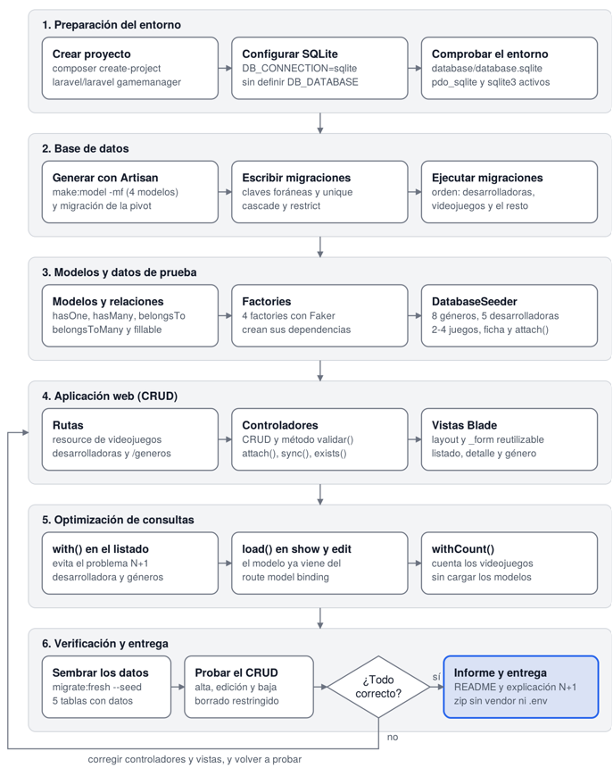

---

## 2. Creación del proyecto

Se crea un proyecto Laravel 12 nuevo y se accede a su carpeta:

```bash
composer create-project laravel/laravel gamemanager "^12.0"
cd gamemanager
```

Todos los comandos `php artisan` se ejecutan desde la raíz del proyecto, es decir, la carpeta que contiene el archivo `artisan`. Se comprueba con:

```powershell
dir artisan
```

> Nota: si aparece el error `Could not open input file: artisan`, es que la terminal no está en la raíz del proyecto. Hay que entrar en la carpeta `gamemanager` con `cd gamemanager`.

---

## 3. Configuración de la base de datos (SQLite)

Se usa la base de datos **SQLite** que Laravel 12 crea dentro del proyecto, así no hace falta instalar ni arrancar un servidor de base de datos.

En el archivo `.env` se deja la conexión a SQLite y **no se define** `DB_DATABASE`, para que Laravel use el archivo `database/database.sqlite`:

```env
DB_CONNECTION=sqlite
# DB_HOST=127.0.0.1
# DB_PORT=3306
# DB_DATABASE=laravel
# DB_USERNAME=root
# DB_PASSWORD=
```

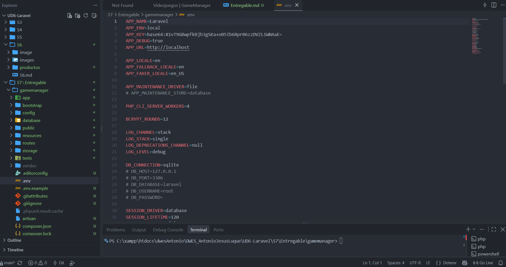

Se comprueba que existe el archivo de la base de datos y que PHP tiene las extensiones necesarias:

```bash
ls database/database.sqlite
php -m | findstr sqlite
```

Deben aparecer `pdo_sqlite` y `sqlite3`. Si no, se activan en `php.ini` quitando el `;` de:

```ini
extension=pdo_sqlite
extension=sqlite3
```

Por último, se revisa que las claves foráneas estén activas en SQLite, porque de ello dependen `cascadeOnDelete()` y `restrictOnDelete()`:

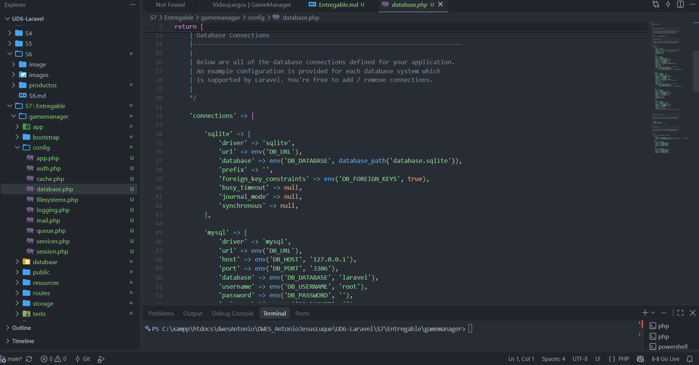

---

## 4. Generación de modelos, migraciones, factories y controladores

Con Artisan se crean los cuatro modelos, cada uno con su migración (`-m`) y su factory (`-f`):

```bash
php artisan make:model Desarrolladora -mf
php artisan make:model Videojuego -mf
php artisan make:model FichaTecnica -mf
php artisan make:model Genero -mf
```

Se crea la migración de la tabla pivot de la relación muchos a muchos:

```bash
php artisan make:migration create_genero_videojuego_table
```

Y los controladores. La opción `--resource` genera los siete métodos habituales de un CRUD (`index`, `create`, `store`, `show`, `edit`, `update`, `destroy`):

```bash
php artisan make:controller VideojuegoController --resource
php artisan make:controller DesarrolladoraController --resource
php artisan make:controller GeneroController
```

> Nota: Laravel pluraliza en inglés, así que la migración de `FichaTecnica` se llama `create_ficha_tecnicas_table`, pero la tabla que creamos se llama `fichas_tecnicas`.

---

## 5. Migraciones

Las migraciones se encuentran en `database/migrations/`. Cada archivo lleva una marca de fecha al principio del nombre (por ejemplo `2026_11_06_000001_create_desarrolladoras_table.php`).

**Orden de ejecución.** Las claves foráneas obligan a crear primero las tablas "padre": `desarrolladoras` → `videojuegos` → `fichas_tecnicas` / `generos` → `genero_videojuego`. Si se generaron en el mismo segundo, se renombran los prefijos de fecha para que respeten este orden.

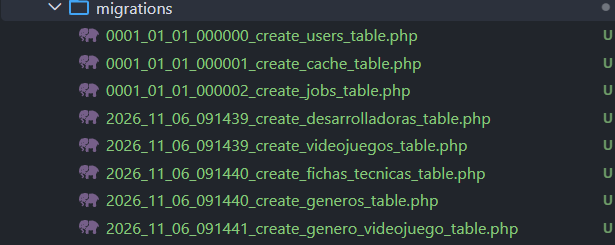

### 5.1 Tabla `desarrolladoras`

Campos: `nombre`, `pais` y `fundacion` (opcional).

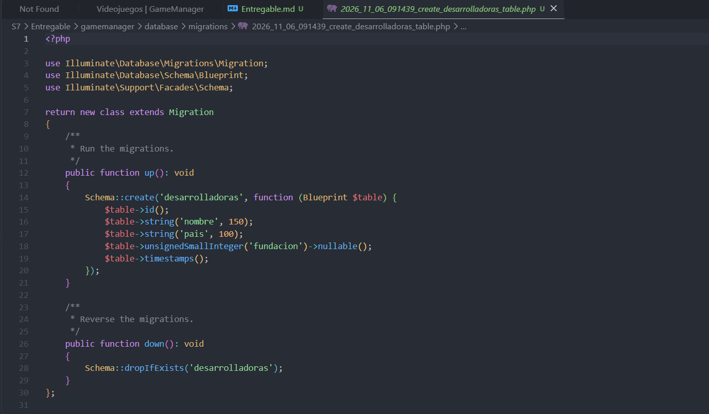

### 5.2 Tabla `videojuegos`

Incluye la clave foránea `desarrolladora_id` con `cascadeOnUpdate()` y `restrictOnDelete()`, de modo que no se puede borrar una desarrolladora que tenga videojuegos.

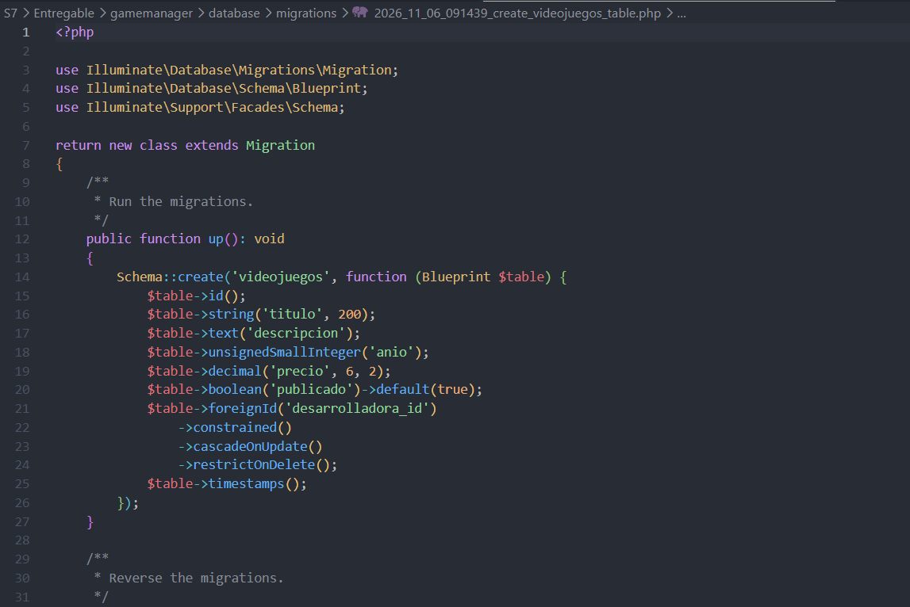

### 5.3 Tabla `fichas_tecnicas`

La clave foránea `videojuego_id` lleva `unique()`, lo que garantiza que un videojuego no tenga más de una ficha técnica (relación uno a uno), y `cascadeOnDelete()`, para que la ficha se borre con el videojuego.

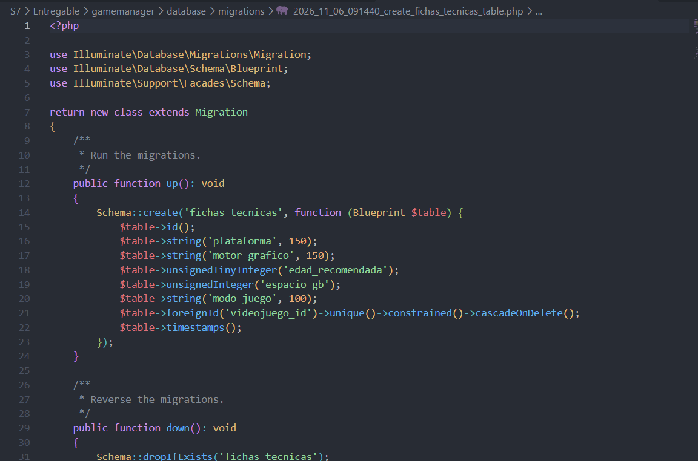

### 5.4 Tabla `generos`

El nombre del género es único.

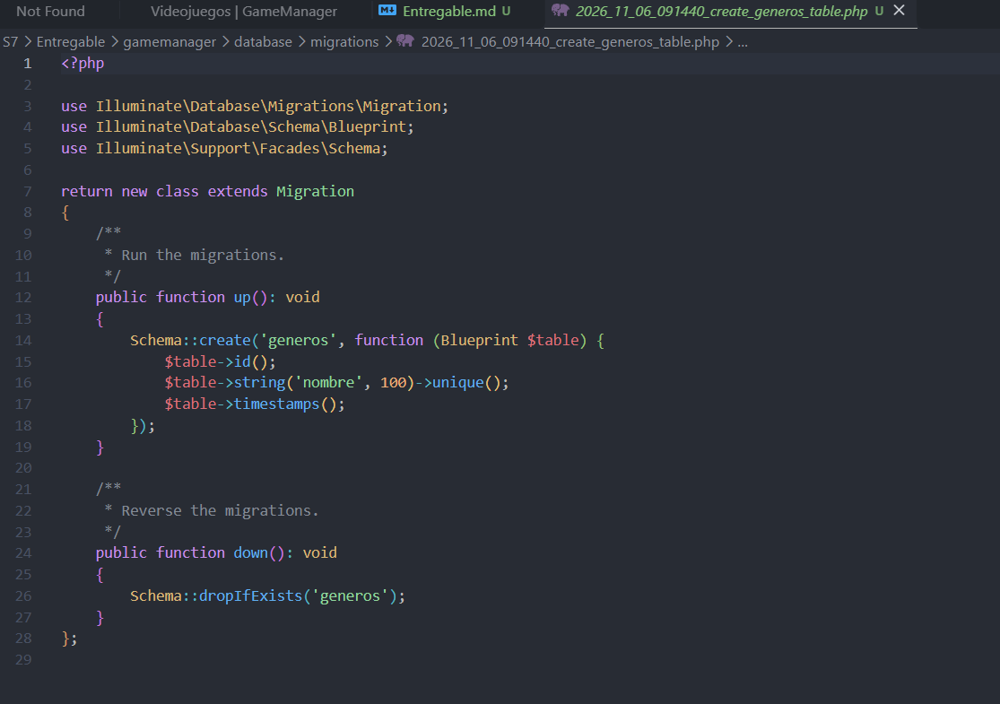

### 5.5 Tabla pivot `genero_videojuego`

Tiene dos claves foráneas con `cascadeOnDelete()` y un índice único compuesto `unique(['genero_id', 'videojuego_id'])`, que impide asignar dos veces el mismo género a un videojuego.

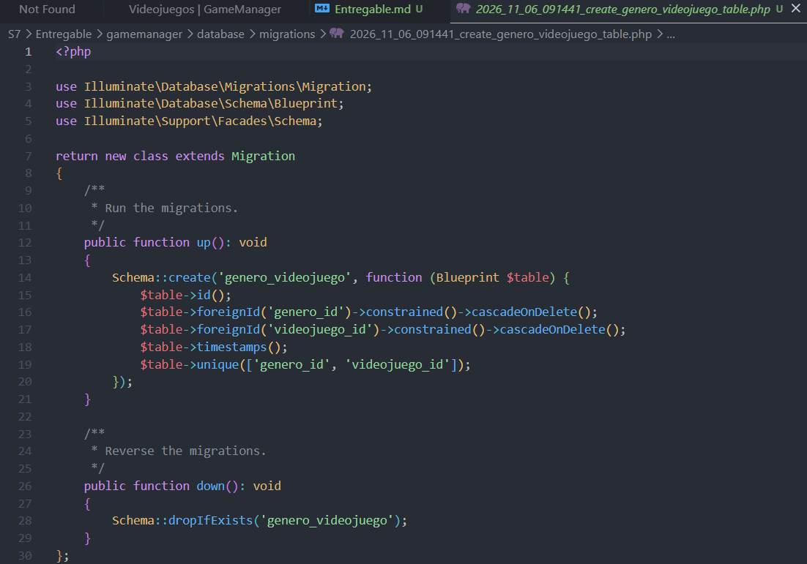

### 5.6 Ejecución de las migraciones

```bash
php artisan migrate
```

---

## 6. Modelos y relaciones Eloquent

Los modelos están en `app/Models/`. Todos usan `HasFactory` y definen `$fillable` para permitir la asignación masiva.

### 6.1 Modelo `Desarrolladora`

Define la relación uno a muchos con `hasMany()`.

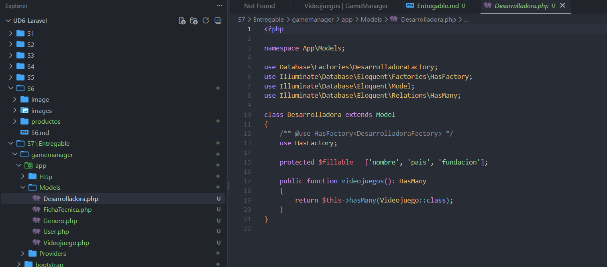

### 6.2 Modelo `Videojuego`

Es el modelo central: pertenece a una desarrolladora (`belongsTo`), tiene una ficha técnica (`hasOne`) y pertenece a varios géneros (`belongsToMany` con `withTimestamps()`). Además define `casts()` para `publicado` (boolean) y `precio` (decimal con 2 decimales).

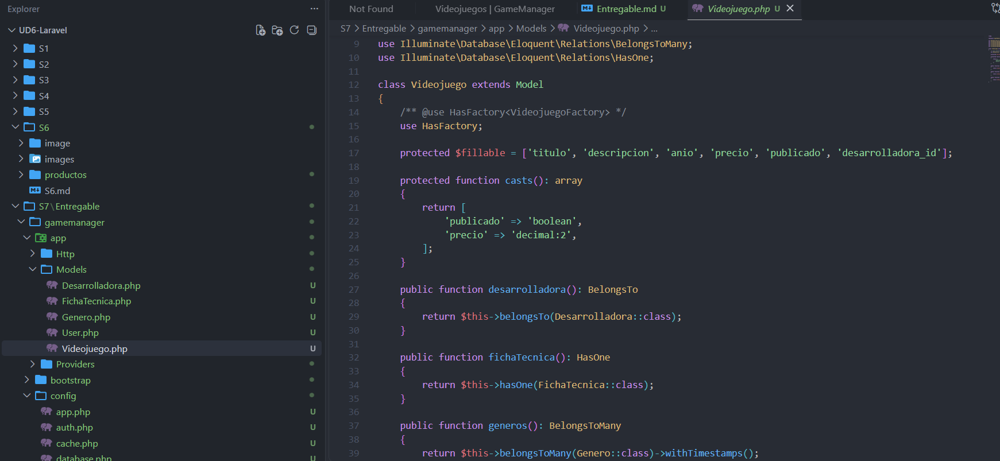

### 6.3 Modelo `FichaTecnica`

Declara `protected $table = 'fichas_tecnicas'` porque el plural en español no coincide con la convención inglesa de Eloquent. Define la relación inversa con `belongsTo()`.

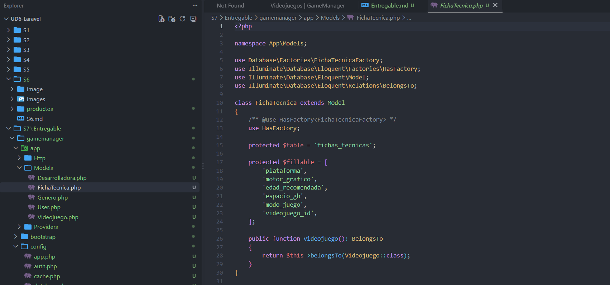

### 6.4 Modelo `Genero`

Define la relación muchos a muchos con `belongsToMany()`.

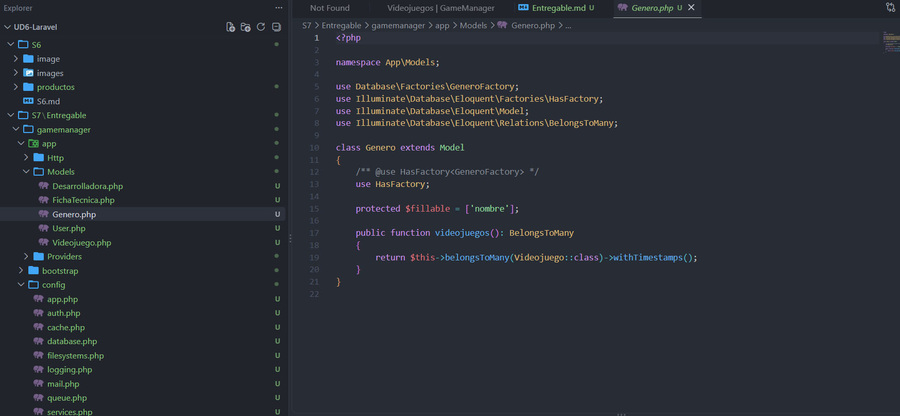

---

## 7. Factories

Las factories generan datos de prueba con Faker. Están en `database/factories/`.

### 7.1 `DesarrolladoraFactory`

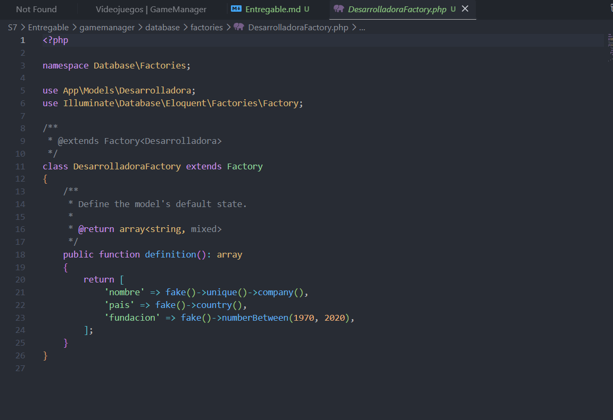

### 7.2 `VideojuegoFactory`

La expresión `Desarrolladora::factory()` en `desarrolladora_id` crea automáticamente una desarrolladora cuando se genera un videojuego sin ninguna asignada.

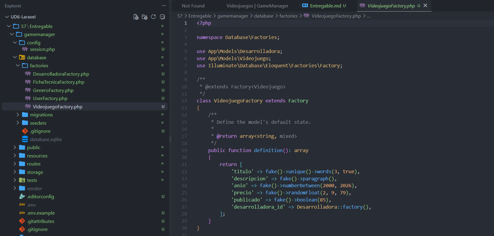

### 7.3 `FichaTecnicaFactory`

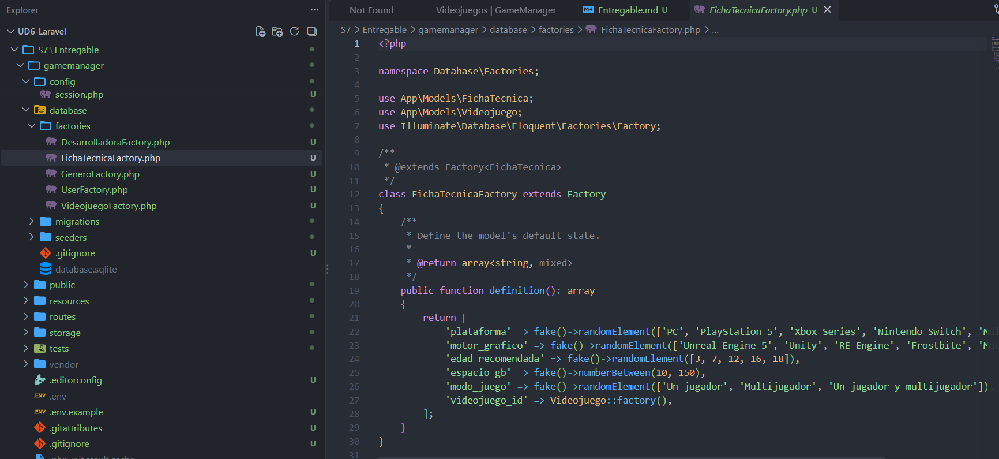

### 7.4 `GeneroFactory`

Existe la factory, pero los géneros principales se definen a mano en el seeder para evitar nombres aleatorios poco adecuados.

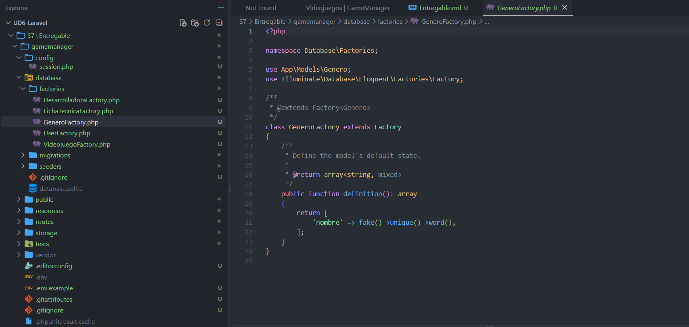

---

## 8. Seeder principal

El `DatabaseSeeder` realiza estas operaciones:

1. Crea ocho géneros fijos (Acción, Aventura, Rol, Estrategia, Deportes, Simulación, Mundo abierto y Plataformas).
2. Crea cinco desarrolladoras.
3. Crea entre dos y cuatro videojuegos por desarrolladora.
4. Crea una ficha técnica por cada videojuego.
5. Asigna entre uno y tres géneros a cada videojuego con `attach()`.

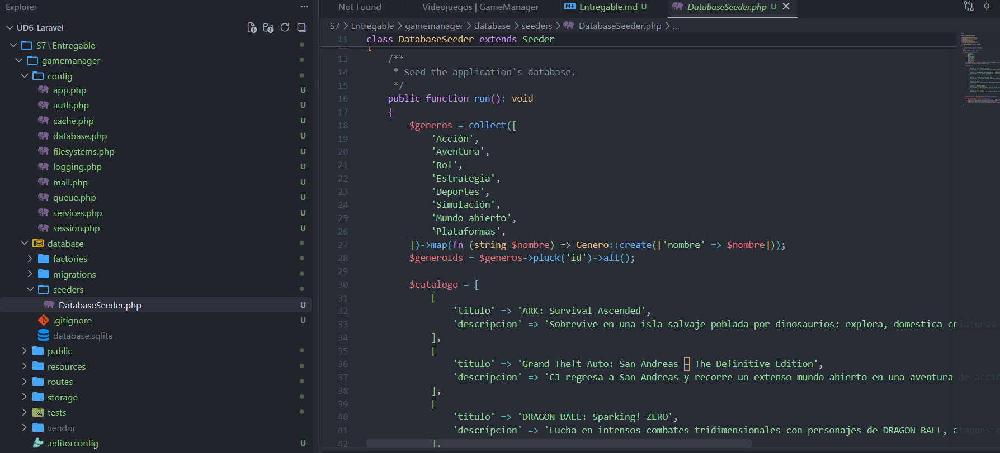

Para reiniciar la base de datos y cargar los datos:

```bash
php artisan migrate:fresh --seed
```

---

## 9. Rutas

En `routes/web.php` se define:

- `/` redirige al listado de videojuegos.
- `Route::resource('videojuegos', ...)` crea todas las rutas del CRUD.
- `Route::resource('desarrolladoras', ...)->except(['show'])` crea el CRUD de desarrolladoras sin la vista de detalle.
- `/generos/{genero}` muestra los videojuegos de un género.

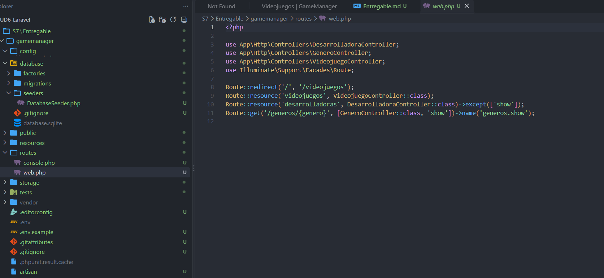

Se comprueban con:

```bash
php artisan route:list
```

---

## 10. Controladores

Los controladores están en `app/Http/Controllers/`.10.1 `VideojuegoController`

Es el CRUD principal. Sus métodos son:

| Método       | Función                                                                                                                 |
| ------------- | ------------------------------------------------------------------------------------------------------------------------ |
| `index()`   | Lista los videojuegos con `with(['desarrolladora', 'generos'])`, ordenados por más recientes y paginados de 10 en 10. |
| `create()`  | Carga desarrolladoras y géneros para el formulario.                                                                     |
| `store()`   | Valida, crea el videojuego, crea su ficha con `fichaTecnica()->create()` y asocia los géneros con `attach()`.       |
| `show()`    | Carga las relaciones con `load()` y muestra el detalle.                                                                |
| `edit()`    | Carga ficha y géneros con `load()` y muestra el formulario.                                                           |
| `update()`  | Actualiza el videojuego, la ficha con `updateOrCreate()` y los géneros con `sync()`.                                |
| `destroy()` | Elimina el videojuego.                                                                                                   |
| `validar()` | Método privado con las reglas de validación, reutilizado por `store()` y `update()`.                               |

```php
<?php

namespace App\Http\Controllers;

use App\Models\Desarrolladora;
use App\Models\Genero;
use App\Models\Videojuego;
use Illuminate\Http\RedirectResponse;
use Illuminate\Http\Request;
use Illuminate\Support\Arr;
use Illuminate\View\View;

class VideojuegoController extends Controller
{
    public function index(Request $request): View
    {
        $videojuegos = Videojuego::with(['desarrolladora', 'generos'])
            ->when($request->filled('buscar'), fn ($query) => $query->where('titulo', 'like', '%'.$request->string('buscar')->toString().'%'))
            ->when($request->filled('genero_id'), fn ($query) => $query->whereHas('generos', fn ($generos) => $generos->whereKey($request->input('genero_id'))))
            ->when($request->filled('desarrolladora_id'), fn ($query) => $query->where('desarrolladora_id', $request->input('desarrolladora_id')))
            ->latest()
            ->paginate(10)
            ->withQueryString();

        return view('videojuegos.index', [
            'videojuegos' => $videojuegos,
            'generos' => Genero::orderBy('nombre')->get(),
            'desarrolladoras' => Desarrolladora::orderBy('nombre')->get(),
        ]);
    }

    public function create(): View
    {
        return view('videojuegos.create', [
            'desarrolladoras' => Desarrolladora::orderBy('nombre')->get(),
            'generos' => Genero::orderBy('nombre')->get(),
        ]);
    }

    public function store(Request $request): RedirectResponse
    {
        $datos = $this->validar($request);
        $datos['publicado'] = $request->boolean('publicado');

        $videojuego = Videojuego::create(Arr::only($datos, [
            'titulo',
            'descripcion',
            'anio',
            'precio',
            'publicado',
            'desarrolladora_id',
        ]));

        $videojuego->fichaTecnica()->create(Arr::only($datos, [
            'plataforma',
            'motor_grafico',
            'edad_recomendada',
            'espacio_gb',
            'modo_juego',
        ]));
        $videojuego->generos()->attach($datos['generos']);

        return redirect()->route('videojuegos.index')->with('mensaje', 'Videojuego creado correctamente.');
    }

    public function show(Videojuego $videojuego): View
    {
        $videojuego->load(['desarrolladora', 'fichaTecnica', 'generos']);

        return view('videojuegos.show', compact('videojuego'));
    }

    public function edit(Videojuego $videojuego): View
    {
        $videojuego->load(['fichaTecnica', 'generos']);

        return view('videojuegos.edit', [
            'videojuego' => $videojuego,
            'desarrolladoras' => Desarrolladora::orderBy('nombre')->get(),
            'generos' => Genero::orderBy('nombre')->get(),
        ]);
    }

    public function update(Request $request, Videojuego $videojuego): RedirectResponse
    {
        $datos = $this->validar($request);
        $datos['publicado'] = $request->boolean('publicado');

        $videojuego->update(Arr::only($datos, [
            'titulo',
            'descripcion',
            'anio',
            'precio',
            'publicado',
            'desarrolladora_id',
        ]));
        $videojuego->fichaTecnica()->updateOrCreate(
            ['videojuego_id' => $videojuego->id],
            Arr::only($datos, ['plataforma', 'motor_grafico', 'edad_recomendada', 'espacio_gb', 'modo_juego'])
        );
        $videojuego->generos()->sync($datos['generos']);

        return redirect()->route('videojuegos.show', $videojuego)->with('mensaje', 'Videojuego actualizado correctamente.');
    }

    public function destroy(Videojuego $videojuego): RedirectResponse
    {
        $videojuego->delete();

        return redirect()->route('videojuegos.index')->with('mensaje', 'Videojuego eliminado correctamente.');
    }

    private function validar(Request $request): array
    {
        return $request->validate([
            'titulo' => ['required', 'string', 'max:200'],
            'descripcion' => ['required', 'string'],
            'anio' => ['required', 'integer', 'between:1970,2030'],
            'precio' => ['required', 'numeric', 'min:0', 'max:9999.99'],
            'desarrolladora_id' => ['required', 'exists:desarrolladoras,id'],
            'generos' => ['required', 'array', 'min:1'],
            'generos.*' => ['exists:generos,id'],
            'plataforma' => ['required', 'string', 'max:150'],
            'motor_grafico' => ['required', 'string', 'max:150'],
            'edad_recomendada' => ['required', 'integer', 'in:3,7,12,16,18'],
            'espacio_gb' => ['required', 'integer', 'min:1'],
            'modo_juego' => ['required', 'string', 'max:100'],
        ]);
    }
}
```

Esto genera 1 consulta para los videojuegos y N consultas para las desarrolladoras. Con diez videojuegos se realizan once consultas.

### La solución: eager loading

```php
$videojuegos = Videojuego::with('desarrolladora')->get();
```

Laravel hace solo 2 consultas: una para los videojuegos y otra para las desarrolladoras, sin importar cuántos videojuegos haya.

### Dónde se aplica en el proyecto

| Técnica                                | Dónde                                | Motivo                                                                                          |
| --------------------------------------- | ------------------------------------- | ----------------------------------------------------------------------------------------------- |
| `with(['desarrolladora', 'generos'])` | `VideojuegoController::index()`     | Evita consultas extra al pintar el listado.                                                     |
| `load([...])`                         | `show()` y `edit()`               | El modelo ya viene cargado por route model binding, así que las relaciones se cargan después. |
| `load('videojuegos.desarrolladora')`  | `GeneroController::show()`          | Relación anidada.                                                                              |
| `withCount('videojuegos')`            | `DesarrolladoraController::index()` | Cuenta videojuegos sin cargar los modelos.                                                      |

---

---

## Problemas encontrados y soluciones

| Problema                                             | Solución                                                                                                                                               |
| ---------------------------------------------------- | ------------------------------------------------------------------------------------------------------------------------------------------------------- |
| `Could not open input file: artisan`               | La terminal no estaba en la raíz del proyecto. Se entra en la carpeta que contiene `artisan` (`cd gamemanager`).                                   |
| Las migraciones fallan por las claves foráneas      | Se ajustan los prefijos de fecha de los archivos para que `desarrolladoras` y `videojuegos` se ejecuten antes que las tablas que dependen de ellas. |
| Laravel pluraliza en inglés (`ficha_tecnicas`)    | Se define `protected $table = 'fichas_tecnicas'` en el modelo `FichaTecnica`.                                                                       |
| Error al usar SQLite con `DB_DATABASE=gamemanager` | No se define `DB_DATABASE`, para que se use `database/database.sqlite`.                                                                             |
| PHP no encuentra SQLite                              | Se activan `pdo_sqlite` y `sqlite3` en `php.ini`.                                                                                                 |
| Los iconos de la paginación salen enormes           | Se limita su tamaño con CSS en la plantilla (`nav svg { width: 20px; height: 20px; }`).                                                              |
