# Diario de desarrollo · AutoTienda

### Objetivo

Desarrollar una aplicación web en Laravel 13 para gestionar el catálogo de una tienda de coches, con tres modelos de negocio (`Car`, `Brand`, `Feature`), una relación 1:N, una relación N:M con tabla pivote, CRUD completo con vistas Blade, validación, datos de demostración con Factory y Seeders, búsqueda, filtro y paginación.

### Logros

- **Diseño:** esquema de tres modelos con sus atributos, relación 1:N (`Brand` → `Car`) y N:M (`Car` ↔ `Feature`) con pivote `car_feature`. Documentado en `docs/01-diseno.md`.
- **Base de datos:** migraciones de `brands`, `features`, `cars` y `car_feature`, con claves foráneas y clave primaria compuesta en la pivote. Comprobado con `php artisan db:table`.
- **Catálogo de lectura:** `index` y `show` con consultas Eloquent y carga anticipada (`with()`), mostrando la marca (1:N) y los extras (N:M). Los registros inexistentes devuelven un 404 controlado.
- **CRUD funcional:** `create`, `store`, `edit`, `update` y `destroy` con formularios Blade, `@csrf`, `@method`, `old()`, mensajes flash y sincronización de extras con `sync()`.
- **Validación:** Form Request `CarRequest` con reglas de obligatoriedad, longitud, tipo, rango y claves foráneas, y mensajes en español.
- **Datos de demostración:** `CarFactory` con Faker, seeders de marcas, extras y coches, 3 coches fijos reconocibles y 20 generados, relaciones N:M sin duplicados, todo registrado en `DatabaseSeeder`.
- **Calidad:** búsqueda por modelo, filtro por marca, paginación con Bootstrap y página 404 propia.

### Cambios realizados

- `database/migrations/`: cuatro migraciones (`brands`, `features`, `cars`, `car_feature`).
- `app/Models/`: `Car` (con `$fillable`, `$casts`, `belongsTo` y `belongsToMany`), `Brand` (`hasMany`) y `Feature` (`belongsToMany`).
- `app/Http/Controllers/CarController.php`: Resource Controller con las siete acciones.
- `app/Http/Requests/CarRequest.php`: validación compartida por `store` y `update`.
- `routes/web.php`: `Route::resource('cars', CarController::class)` y redirección de `/` al catálogo.
- `resources/views/`: layout, listado, detalle, creación, edición, parcial `_form` y página 404.
- `app/Providers/AppServiceProvider.php`: paginación con estilo Bootstrap.
- `database/factories/` y `database/seeders/`: datos de demostración.

**Decisiones técnicas:**

- La clave foránea de `cars.brand_id` usa `restrictOnDelete()`: no se puede borrar una marca que tenga coches, para conservar la integridad.
- La tabla pivote usa clave primaria compuesta `(car_id, feature_id)` para impedir duplicados y `cascadeOnDelete()` para limpiarse al borrar un coche o un extra.
- `Feature` describe el equipamiento del coche, no un inventario: no se guardan existencias por extra.
- Se utilizan `sync()` para persistir la N:M y `with()` para evitar el problema N+1.
- Se usa Form Request para sacar la validación del controlador y reutilizarla en `store` y `update`.
- Se utiliza SQLite en lugar de MySQL/MariaDB por simplicidad de instalación: el proyecto se reproduce sin servidor de base de datos. Las migraciones y los modelos serían los mismos con MySQL.

### Error o dificultad

Al intentar crear la base de datos desde la terminal de Windows (PowerShell) con el comando `mysql -u root -p -e "CREATE DATABASE ..."`, apareció el error:

```text
mysql : El término 'mysql' no se reconoce como nombre de un cmdlet, función, archivo de script o programa ejecutable.
```

### Diagnóstico y solución

**Causa:** el cliente `mysql` no estaba instalado o no estaba en el `PATH` del sistema, por lo que PowerShell no encontraba el ejecutable.

**Solución:** en lugar de configurar el entorno de MySQL, se optó por SQLite, que Laravel soporta de forma nativa. Pasos: configurar `DB_CONNECTION=sqlite` en el `.env`, comprobar que existía `database/database.sqlite` (creándolo si faltaba) y verificar las extensiones `pdo_sqlite` y `sqlite3` con `php -m`.

**Aprendido:** Laravel abstrae el motor de base de datos a través de migraciones y Eloquent, de modo que el cambio de motor no obliga a modificar modelos, migraciones ni controladores. También que la sintaxis de PowerShell difiere de la de Bash (por ejemplo, `mkdir` no usa `-p` y no existe `zip`, que se sustituye por `Compress-Archive`).

### Evidencias

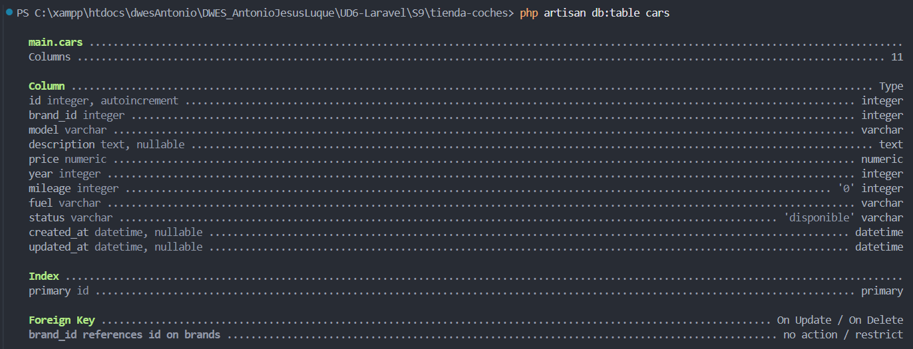

La tabla cars con la clave foránea brand_id hacia brands.

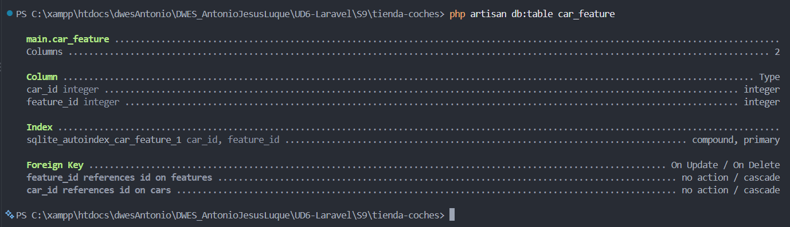
*La tabla `car_feature` con clave primaria compuesta, que impide combinaciones repetidas.*

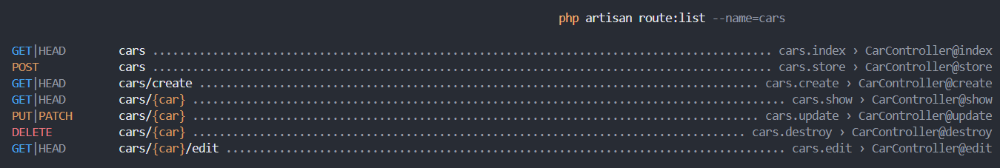
*Las siete rutas con nombre generadas por `Route::resource`.*

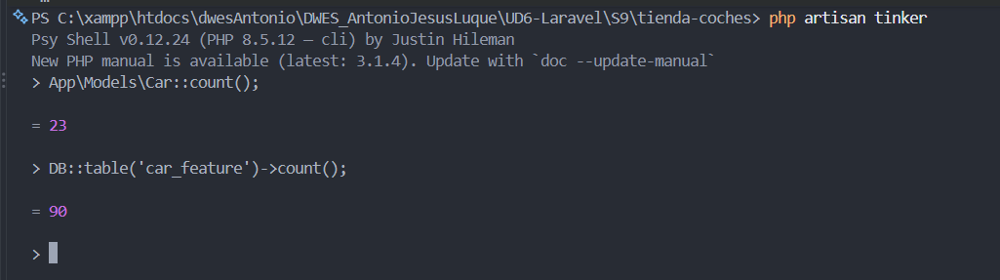
*Listado con marca (1:N), número de extras (N:M), búsqueda, filtro y paginación.*

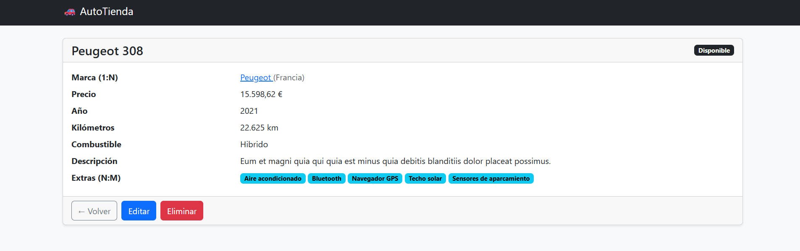
*Detalle con la marca y varios extras asociados.*

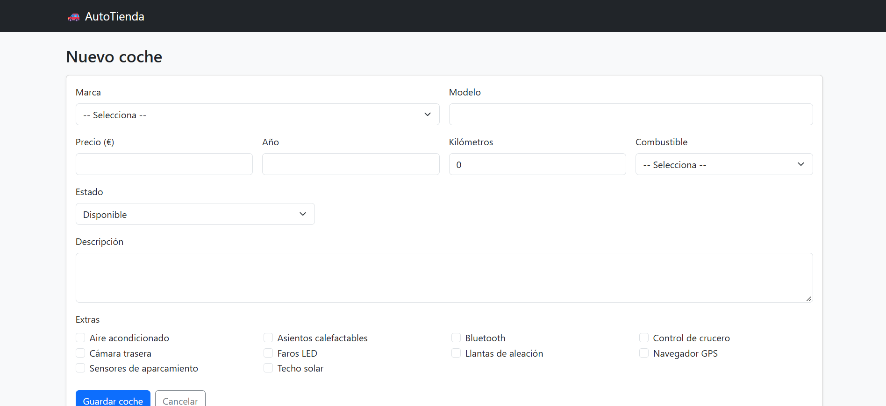
*Formulario con selección múltiple de extras mediante casillas.*

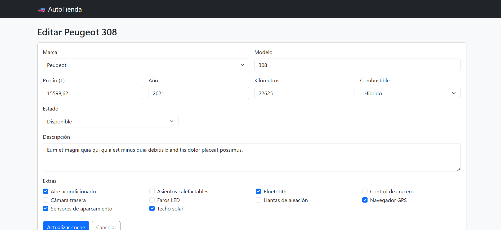
*Registro actualizado con mensaje de éxito y extras sincronizados.*

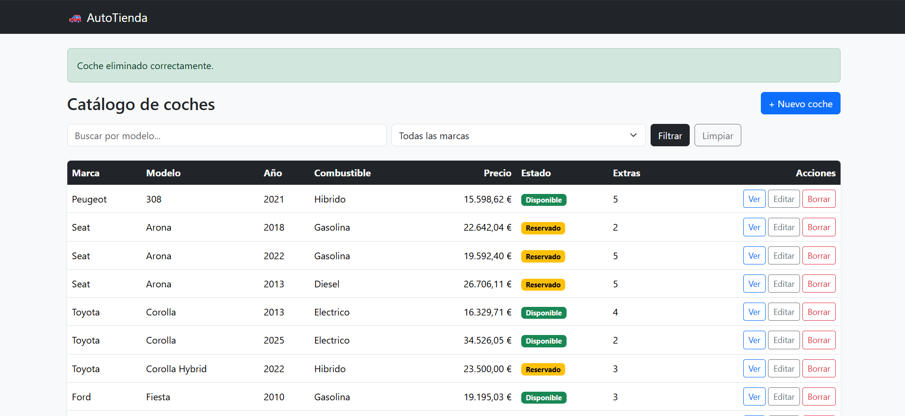
*Registro eliminado con mensaje de confirmación.*

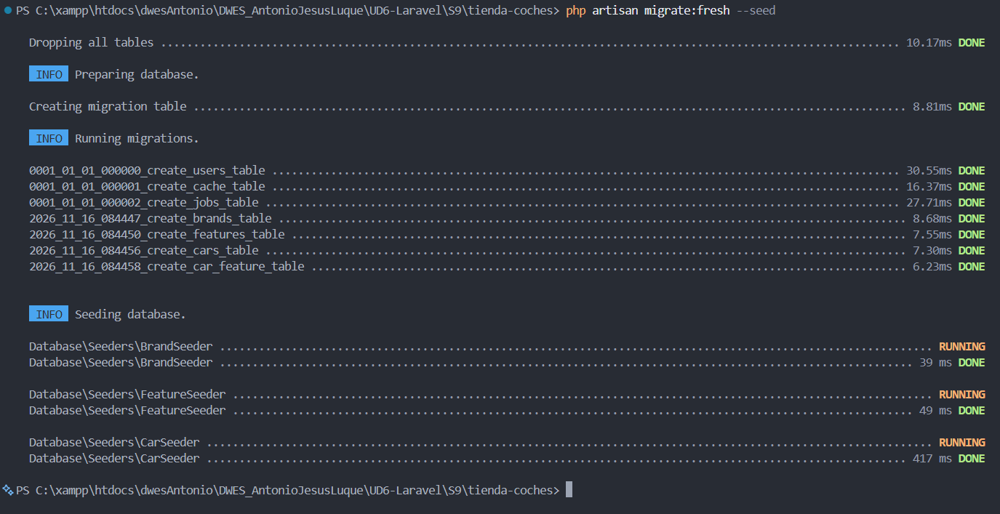
*Ejecución de `php artisan migrate:fresh --seed` sin errores.*

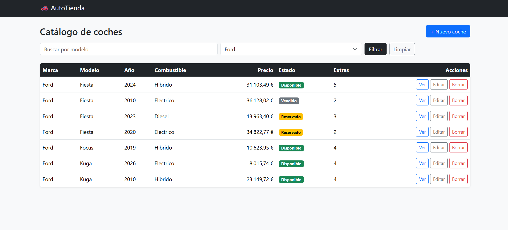
*Filtro por marca aplicado, manteniendo la paginación.*

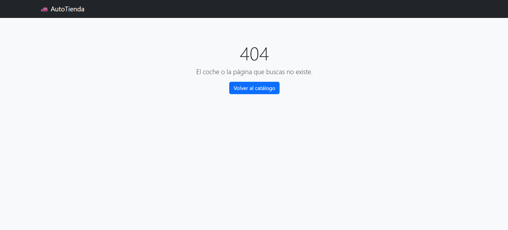
*Respuesta 404 controlada al consultar un coche inexistente*
