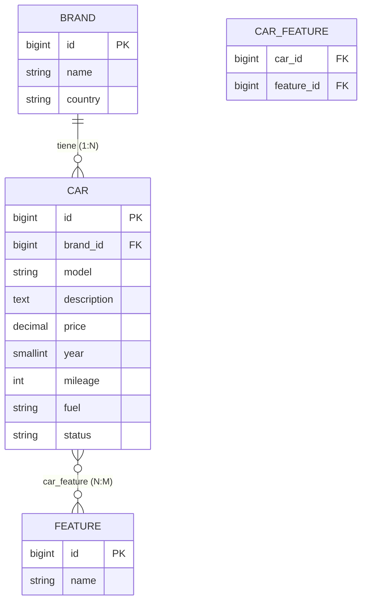

# Diseño – Tienda de coches

## Problema que resuelve
Catálogo web de un concesionario de coches de segunda mano: permite consultar,
buscar, crear, editar y eliminar coches, indicando su marca y su equipamiento.

## Diagrama

## Modelos y campos

| Modelo      | Campo              | Tipo          | Notas                                |
|-------------|--------------------|---------------|--------------------------------------|
| Brand       | id                 | bigint        | PK                                   |
| Brand       | name               | string(100)   | único                                |
| Brand       | country            | string(100)   | opcional                             |
| Car         | id                 | bigint        | PK                                   |
| Car         | brand_id           | bigint        | FK → brands.id                       |
| Car         | model              | string(100)   | obligatorio                          |
| Car         | description        | text          | opcional                             |
| Car         | price              | decimal(10,2) | obligatorio                          |
| Car         | year               | smallint      | año de matriculación                 |
| Car         | mileage            | int           | kilómetros                           |
| Car         | fuel               | string(20)    | gasolina, diesel, hibrido, electrico |
| Car         | status             | string(20)    | disponible, reservado, vendido       |
| Feature     | id                 | bigint        | PK                                   |
| Feature     | name               | string(100)   | único                                |
| car_feature | car_id, feature_id | bigint        | PK compuesta, evita duplicados       |

## Pantallas del Resource Controller (`cars`)

| Acción  | Ruta                 | Pantalla           |
|---------|----------------------|--------------------|
| index   | GET /cars            | Listado            |
| create  | GET /cars/create     | Formulario nuevo   |
| store   | POST /cars           | Guardar nuevo      |
| show    | GET /cars/{car}      | Detalle            |
| edit    | GET /cars/{car}/edit | Formulario edición |
| update  | PUT /cars/{car}      | Actualizar         |
| destroy | DELETE /cars/{car}   | Eliminar           |

## Comprobación: ¿por qué una relación necesita pivote y la otra no?
- **Brand → Car (1:N):** cada coche pertenece a *una sola* marca, así que basta
  una clave foránea `brand_id` en `cars`.
- **Car ↔ Feature (N:M):** un coche tiene *varios* extras y un mismo extra está
  en *varios* coches. Una sola FK no puede representarlo, hace falta la tabla
  intermedia `car_feature` con `car_id` y `feature_id`.

## Justificación del modelo de datos
`Feature` describe el equipamiento del coche, no un inventario individual:
no se guarda stock por extra.

## Base de datos
Se usa SQLite por simplicidad de instalación (no requiere servidor). Las
migraciones y relaciones son las mismas que en MySQL/MariaDB.